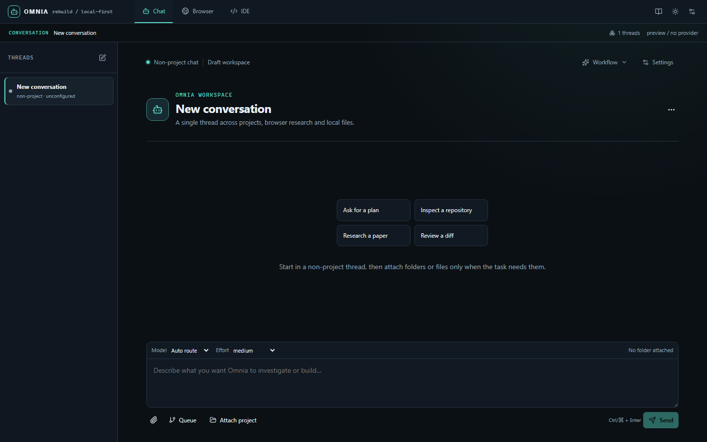
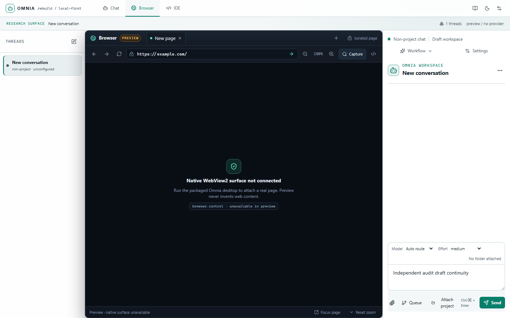
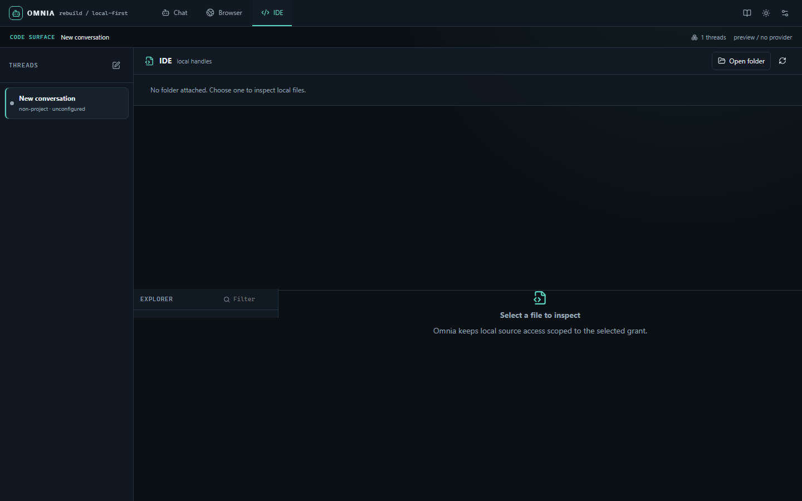
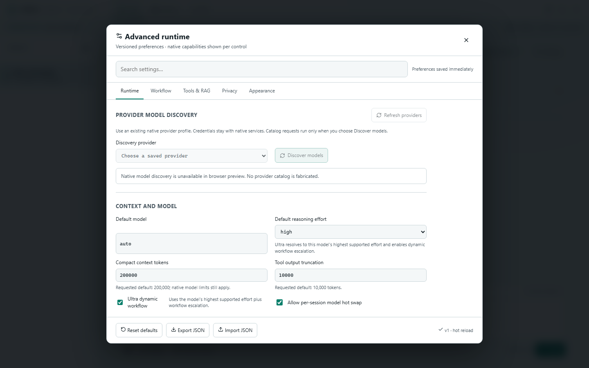
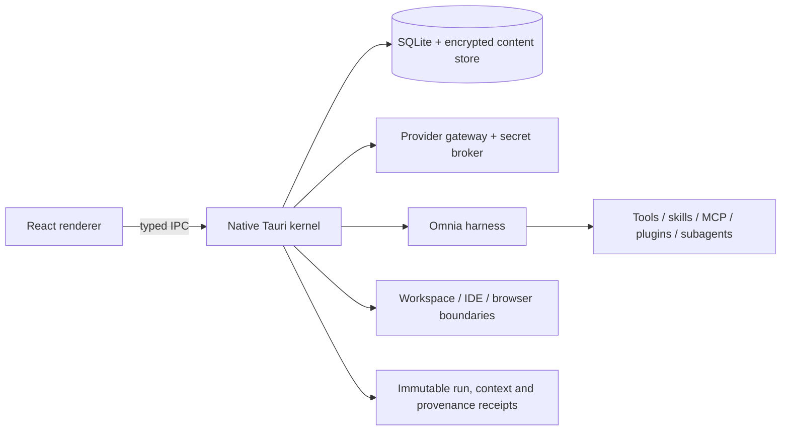

# Omnia

**Local first AI workbench for chat, projects, IDE and browser workflows.**



Omnia is a Windows desktop AI workspace built for people who need more than a chat box. It combines durable conversations, project scoped context, provider neutral model routing, a native trust boundary, IDE and browser surfaces, and an inspectable harness for plans, tools, skills, MCP servers, plugins and subagents.

The project exists to make advanced AI work reproducible. A run should show what was admitted, which provider was selected, which tools were allowed, how context was retrieved, what was persisted, and what still needs review. The native host owns credentials, storage, permissions and external process boundaries; the renderer owns presentation and interaction.

> **Release snapshot:** Omnia 0.1.0 clean-room rebuild preview. The repository is actively being completed toward the 240-criterion DoD matrix in [`docs/rebuild/DOD.json`](docs/rebuild/DOD.json). The rebuild gate is the authority for done, partial, blocked and planned criteria.

## Clean-room renderer preview

The current rebuild is a fresh renderer under `src/rebuild`. It has one shared
session model and exactly three top-level surfaces: **Chat**, **Browser** and
**IDE**. These screenshots were captured from the local Vite preview at
1440×900 on 2026-11-08. They are preview evidence, so the Browser image
intentionally reports that the native WebView2 surface is unavailable outside
the packaged desktop runtime.

| Chat | Browser | IDE | Advanced settings |
| --- | --- | --- | --- |
|  |  |  |  |

The preview build verifies the navigation shell, non-project-first Chat,
shared session sidebar, explicit unavailable native states, local IDE chrome,
folder/file access boundaries and versioned advanced runtime settings. Native
provider execution, durable native persistence and packaged WebView2 behavior
remain separately tracked in [`docs/rebuild/DOD.json`](docs/rebuild/DOD.json).

## Primary surfaces

Omnia opens in **Chat**, with a non project conversation by default. A project can be selected from the same Chat surface, so project and non project sessions share one session list and one workflow. **Browser** and **IDE** are the other two persistent top level modes; each keeps the shared Chat session sidebar available while its workbench is open. Projects, Work, Library, Memory and Skills remain Chat routes rather than separate top level products. The shell supports light and dark themes, keyboard navigation and a compact glass style that keeps the work area in focus.

## What is working in this snapshot

- **Chat and sessions:** non project chat, project chat, durable session tabs, branch/fork/rewind controls, optimistic stream recovery, retry/steer/interrupt flows, and native run journal projections.
- **Projects and context:** project scoped folders and file pointers, native identity and revision checks, read only workspace grants, lexical workspace indexing, bounded retrieval and immutable context snapshots. A content-free RAG provider contract now validates capability, lineage, budgets and receipts; native retrieval admission and a deterministic local reranker are covered by same-snapshot receipts. Live external embedding/reranker dispatch remains explicitly separated until a provider connector is authenticated and observed.
- **Providers and routing:** OpenAI, Anthropic, Gemini, OpenAI compatible and approved local endpoints through native adapters; capability aware parameters, effort routing, usage projections, provider lineage, and opaque prepared input dispatch.
- **Native model compare:** the snapshot contains a bounded two-to-four route fan-out engine, route conversion checks, provenance projections and immutable merge receipt types. Durable attempt journaling, live native dispatch and billing lineage remain partial or unverified in the completion ledger, so this is not presented as a fully shipped compare workflow.
- **IDE surface:** workspace tabs, semantic tab/panel relationships, editor settings focus behavior, editor attachment, LSP configuration and native editor surface contracts with explicit workspace trust and permission boundaries.
- **Browser and computer harness:** dedicated browser workbench, navigation and bounded capture receipts, zoom/lifecycle persistence, downloads, recording and computer permission contracts. The browser preview is deterministic and local; packaged WebView2 and external-service evidence remains in the ledger as partial.
- **Skills, tools, MCP, plugins and subagents:** precedence-aware skill and role discovery, plugin registry, trust-gated MCP status/reload, connector receipts, tool DAGs, parallel task coordination and shared token budgets. Packaged connector execution and live external-service coverage remain contract-level unless a receipt says otherwise.
- **Artifacts and portability:** bounded artifact preview/export, redacted import/export, encrypted binary preview contracts, checkpoints and review-oriented workspace diffs.
- **Multimodal planning:** capability-gated image, video, audio and document endpoint plans with deterministic fingerprints and idempotency keys. Provider wire payloads, upload bytes and credentials remain native-only until a live adapter receipt exists.
- **Research and observability:** bounded research fan out with source span receipts, telemetry projections, performance evidence and synthetic provider billing reconciliation fixtures.
- **Retry posture:** the runtime settings surface defaults to retrying incomplete sessions after errors with a 5 second delay, multiplier 1, no jitter, unlimited attempts and no elapsed-time cap. Provider/model fallback and prompt repair remain explicit opt-ins; native acceptance and idempotency gates still decide whether a resend is safe.
- **Quality gates:** TypeScript and Rust checks, command parity, ACL/import/typography/hit target checks, upstream catalog determinism, focused Vitest suites and canonical native integration tests.

## Architecture



The renderer never receives provider credentials, raw credential references, unrestricted filesystem handles, or arbitrary process launch authority. Prepared runs resolve messages, parameters, provider definitions and lineage in native storage before dispatch. External network, browser, computer and process adapters require explicit policy and produce bounded receipts.

## Upstream reuse

`upstream_extractions/` is audited as a source of reusable contracts and test ideas, not copied blindly into the renderer. The current catalog covers **55 modules in 11 categories** including Claude and Codex lifecycle patterns, OpenHands plugin fixtures, MCP transport contracts, skills precedence, subagent roles, reasoning/usage accounting, retrieval workflows, browser surfaces and process adapters.

- Inventory: [`docs/UPSTREAM_INTEGRATION_INVENTORY.md`](docs/UPSTREAM_INTEGRATION_INVENTORY.md) and the clean-checkout metadata snapshot in `src/domain/upstream-capability-catalog.snapshot.json`
- Reuse ledger and boundaries: [`docs/UPSTREAM_HARNESS_INTEGRATION_20261107.md`](docs/UPSTREAM_HARNESS_INTEGRATION_20261107.md)
- Deterministic catalog: `npm run check:upstream-catalog`

Sensitive browser profiles, cookies, credentials, proprietary binaries and runtime state remain evidence only unless a bounded native adapter exists with permission and receipt tests.

## Run Omnia locally

### Prerequisites

- Windows 11 with WebView2 Runtime
- Node.js 22 or newer and npm 10 or newer
- Rust stable and Cargo for the native desktop build
- Microsoft C++ Build Tools for Tauri packaging

### Install and start

```powershell
npm ci
npm run preview:fast       # renderer preview at http://127.0.0.1:1420/
npm run desktop:dev       # full Tauri desktop app
```

The browser preview is safe for layout and interaction work. Provider credentials, native projects, workspace grants, encrypted storage and live provider dispatch require the Tauri desktop runtime.

### Build and verify

```powershell
npm run typecheck:app -- --pretty false
npm run check:command-parity
npm run check:upstream-catalog
npm run test
npm run build
cargo check --manifest-path src-tauri/Cargo.toml --offline
cargo test --manifest-path src-tauri/Cargo.toml --workspace --all-features --offline
```

The current rebuild cycle has dated receipts for a 98-test renderer suite across 16 files, TypeScript typecheck, renderer build, architecture/import guard, workflow-gate validation, UI captures at 800×600 and 1440×900, and provider-neutral native ask-user/RAG contract evidence. These receipts cover local renderer and provider-neutral native contract paths. Packaged WebView2, live provider billing, GPU/DPI and long-running endurance evidence remain explicitly tracked as partial or blocked in [`docs/rebuild/DOD.json`](docs/rebuild/DOD.json).

The canonical native integration target is the `omnia_native` test target. On some Windows setups, the legacy library-test executable can fail before discovery with `STATUS_ENTRYPOINT_NOT_FOUND (0xc0000139)`; that environment limitation is tracked in the ledger and does not replace the supported integration target.

## First walkthrough

1. Start the desktop app in **Chat** for a non project conversation (project sessions use the same surface).
2. Open **Projects**, create a project and add a read only workspace folder or file pointer.
3. Send a prompt. Native preparation freezes the run, records bounded project retrieval and context receipts when a readable grant is selected, and keeps the user message last. The local deterministic RAG adapter can replay hash-only reranking; external provider admission is shown separately until a live connector receipt exists.
4. Open the inspector to review model, effort, tools, context and usage receipts.
5. Open **Services** to inspect skills, subagent roles, plugin and MCP trust state without launching an external connector.
6. Switch to **IDE** or **Browser** from the top-left primary navigation. The Chat sidebar remains available beside either workbench.

Useful shortcuts:

| Shortcut | Action |
| --- | --- |
| `Ctrl+K` | Command palette |
| `Ctrl+N` | New conversation |
| `Ctrl+Shift+B` | Toggle object sidebar |
| `Ctrl+Shift+I` | Toggle inspector |
| `Enter` | Send |
| `Shift+Enter` | Newline |

## Honest status and next work

Omnia is intentionally reported as a matrix instead of a marketing claim. The rebuild DoD records implementation, focused tests, boundary evidence and same-snapshot receipts for every criterion. The current cycle is **0/240 Done, 24 Partial, 7 Blocked and 209 Planned**. Remaining work includes packaged WebView2 capture/history/download evidence, live provider account billing reconciliation, packaged editor and DPI/accessibility evidence, long-running native performance profiling, durable compare attempt journaling, pointer/RAG runtime proof, and native model discovery refresh.

- Rebuild completion matrix: [`docs/rebuild/DOD.json`](docs/rebuild/DOD.json)
- Rebuild workflow: [`docs/rebuild/WORKFLOW.md`](docs/rebuild/WORKFLOW.md)
- Rebuild checkpoint: [`docs/rebuild/CHECKPOINT.md`](docs/rebuild/CHECKPOINT.md)
- Product scope: [`docs/PRODUCT_SPEC.md`](docs/PRODUCT_SPEC.md)
- Harness architecture: [`docs/HARNESS_ARCHITECTURE.md`](docs/HARNESS_ARCHITECTURE.md)
- Security and storage: [`docs/security-storage-architecture.md`](docs/security-storage-architecture.md)

The project does not treat a specification, an extracted repository or a UI placeholder as a shipped capability. A feature moves to **Done** only when its implementation, focused test, trust boundary and receipt are available on the same snapshot.

## Technology

- Tauri 2 and Rust 2021 native host
- React 19, TypeScript 5.9 and Vite 7 renderer
- SQLite via `rusqlite`, encrypted content store and Windows credential broker
- `reqwest` + Rustls provider gateway with destination validation and cancellation
- Omnia harness provider adapters, tool DAG, skills/MCP/plugin/subagent registry
- Vitest, Testing Library, Playwright and Cargo integration suites

## License and contribution

This repository is an active internship portfolio project. Read the DoD and security/storage documents before adding a connector, provider, tool or native command. Changes that widen filesystem, process, browser, computer or network access must include an explicit policy boundary and a redacted receipt test.
### Rebuild cycle 0006 status

Cycle 0006 adds fresh OSS research (Mastra workflow durability and Monaco editor lifecycle) and refreshed clean-room UI evidence. The browser-preview report records the latest independent checks across 16 states with zero axe violations; it does not represent packaged/native/live provider proof. Current DoD counts are tracked in docs/rebuild/DOD.json and remain incomplete by design.

### Rebuild cycle 0007 status

Cycle 0007 adds the original renderer's catalog route lineage, requested/effective
reasoning-effort resolution and typed ask-user envelope. The focused renderer
receipt reports **63/63 tests passed**, the app typecheck and renderer build pass,
and the independent evidence review is recorded in
[`docs/rebuild/audit/REVIEW_CYCLE7_20261108.json`](docs/rebuild/audit/REVIEW_CYCLE7_20261108.json).
These are renderer and contract receipts. Durable native catalog snapshot
persistence, native `xhigh`/`ultra` adapter behavior, packaged Windows ask-user
UI and live provider execution remain open in the DoD. A stale catalog model can
remain a requested default for continuity, but dispatch remains guarded until a
fresh route is available.

### Rebuild cycle 0008 status

Cycle 0008 adds a new research and native evidence loop for the three highest
current gaps. The cycle records 23 novel path-level OSS research entries with
pinned snapshots, a typed synthesis and a three-pass atomic plan. Native
capability negotiation now has a durable per-session receipt chain and passes
**14/14** focused `omnia_native` tests, including `xhigh`, `ultra`, dynamic
workflow gating, stale revision and tamper rejection. Provider catalog
snapshots are immutable, hashed and bound to prepared-attempt lineage; the
provider gateway suite passes **64/64** tests and the catalog persistence suite
passes **2/2**.

The workflow and renderer gates also pass: **32/32** rebuild gate tests,
architecture/import guard, app typecheck, renderer build and cycle validation.
An independent review is recorded in
[`docs/rebuild/audit/REVIEW_CYCLE8_20261108.json`](docs/rebuild/audit/REVIEW_CYCLE8_20261108.json).
These receipts prove source and provider-neutral native behavior. Packaged
Tauri IPC, Windows UI automation, live provider refresh/ask-user execution,
running-attempt snapshot retention and failed-refresh preservation remain
explicitly open in the DoD; the cycle keeps the matrix at **0/240 Done, 24
Partial, 7 Blocked and 209 Planned**.
