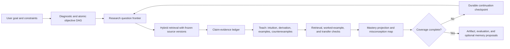

# Omnia learning and research harness

Status: domain foundation implemented; native persistence, retrieval, provider orchestration, and UI are not yet shipped.

Date: 2026-08-13

## 1. Purpose

Omnia needs more than a longer system prompt for serious study and deep research. It needs durable, inspectable state that distinguishes:

- what the learner is trying to master;
- which prerequisites and problem patterns exist;
- what has been taught, practiced, transferred, or misunderstood;
- which research questions are answered, disputed, blocked, or still open;
- which frozen source spans support or contradict each claim;
- what coverage remains when an answer reaches a provider output limit;
- what may be proposed as memory after a run, without silently becoming memory.

The initial implementation lives in `src/domain/learning-research.ts`. It is a provider-neutral contract and does not claim that retrieval, citations, study mode, or research orchestration are already connected end to end.

## 2. Design invariants

### 2.1 Learning is an objective graph

A `LearningPlan` stores a prerequisite DAG of atomic `LearningObjective` records. Every objective has:

- a concept/procedure/problem/proof/implementation/transfer kind;
- a target depth from orientation through frontier knowledge;
- explicit prerequisites;
- observable mastery signals such as explain, derive, debug, teach, and transfer;
- a state and importance score;
- optional research-question provenance.

Creation fails on duplicate IDs, missing prerequisites, self-dependencies, cycles, missing mastery signals, or malformed estimates. The graph is therefore inspectable and schedulable rather than an opaque prose syllabus.

### 2.2 Research uses a claim-evidence ledger

The `ResearchLedger` separates three layers:

1. questions that define the search frontier;
2. immutable evidence records that retain source ID, source version, content hash, span, frozen context snapshot, stance, and verification state;
3. claims that link back to questions, objectives, evidence, and the producing run.

A claim cannot be marked `supported` unless it has verified supporting evidence and no verified contradiction. A claim cannot be marked `disputed` without verified contradicting evidence. Unknown, unverified, mismatched, or unavailable evidence therefore cannot become an invisible truth badge.

### 2.3 Coverage gaps stay visible

`auditResearchCoverage` reports:

- answered-question coverage;
- learning-objective coverage;
- supported-claim rate;
- disputed and unsupported claims;
- unanswered questions and uncovered objectives;
- source diversity;
- verified-evidence rate.

Empty ledgers produce zero coverage instead of a misleading perfect score. Unsupported claims do not count as answered questions.

### 2.4 Mastery requires observable evidence

`projectObjectiveMastery` weights assessment evidence by assessment type and evaluator confidence. High recall alone projects `practicing`, not `mastered`; a transfer assessment is required before mastery can be projected. Misconception tags remain visible, and a review date is projected from the resulting state.

This first policy is intentionally conservative and deterministic. Later adaptive policies may be learned from outcome data, but they must remain versioned, evaluable, user-controllable, and outside security decisions.

### 2.5 Long answers continue from receipts

`LearningContinuationCheckpoint` records exactly:

- completed and remaining objective IDs;
- completed claim IDs;
- unresolved question IDs;
- parent run and frozen context snapshot;
- continuation reason and sequence.

Continuation is monotonic: completed objectives cannot become incomplete, and child checkpoints cannot silently add or remove objective scope. This lets a lesson or research report span multiple answers without relying on a model to infer progress from prose.

### 2.6 Current corrections supersede stale knowledge

This contract does not merge contradictory facts into one claim. New claims may explicitly supersede an older claim; contradicted claims remain auditable. When integrated with Omnia memory, current user corrections and verified source revisions must create a new memory/claim revision and supersede the old one. Both versions remain in provenance, while only the active version enters future context.

## 3. Intended harness flow

The provider never owns this state. It receives a frozen projection selected by the native harness. Provider output is parsed into proposals and must pass deterministic validation before it mutates the ledger.

## 4. Learning response blueprint

The response renderer should eventually support a versioned learning artifact with these optional blocks:

1. orientation and dependency map;
2. definitions and invariants;
3. intuition and first-principles derivation;
4. worked examples from simple to adversarial;
5. counterexamples and failure modes;
6. problem-pattern recognition cues;
7. general solution strategies and complexity trade-offs;
8. implementation and debugging guidance;
9. retrieval questions, hints, and full solutions behind progressive disclosure;
10. transfer problems that differ structurally from examples;
11. evidence map, disagreements, uncertainty, and missing coverage;
12. next objective, review schedule, and continuation receipt.

This is a blueprint, not a requirement that every answer render every block. The harness should choose blocks from the goal, diagnostic evidence, objective state, output budget, and user preference; the inspector must show the resolved response contract.

## 5. Lost-in-the-middle controls

When wired to the context compiler, learning/research runs should add these protected groups:

- current learner goal and exact constraints;
- objective prerequisites for the current frontier;
- active misconception/correction records;
- claims and evidence spans used by the current answer;
- unresolved research questions;
- the most recent continuation checkpoint;
- recent learner answers needed for feedback.

Older exposition is summarizable. Objective IDs, claims, corrections, source spans, assessment outcomes, and unresolved state are not. The context snapshot must show every selected and omitted item and retain derivation lineage for summaries.

## 6. Native and UI integration backlog

The safe integration order is:

1. Add versioned SQLite tables for learning plans, objectives, assessments, research questions, evidence, claims, and continuation checkpoints.
2. Append ledger mutations to the durable run event journal before updating projections.
3. Add IPC that accepts opaque IDs and metadata only; raw source bytes remain in the content store.
4. Connect retrieval snapshots and citation validation to `LearningEvidence`.
5. Add a native prepared research input so the renderer cannot reconstruct provider payloads.
6. Add an inspector with objective graph, coverage, claim/evidence matrix, misconceptions, and continuation state.
7. Add authoring UI for goal, assumed background, depth, time budget, assessment style, citation policy, and source scope, each with a usable default.
8. Add study interactions: hint ladder, Socratic questions, worked examples, quizzes, flashcards, practice variants, teach-back, and spaced review.
9. Add research orchestration: query decomposition, source allow/deny lists, primary-source preference, deduplication, contradiction search, source coverage, and revision.
10. Add evaluation suites before adaptive routing: grounded-QA, prerequisite ordering, misconception recovery, transfer performance, citation support, source diversity, continuation fidelity, and long-context supersession.

## 7. Security and privacy

- Retrieved text and memory remain untrusted data and never become instructions.
- Learning analytics are local-first and require explicit policy before sync or durable sensitive-memory proposals.
- A temporary chat reads or writes no learning profile or memory unless the user explicitly opts in for that run.
- Assessment confidence is not authority; it is only a weight in a visible projection.
- Adaptive routing may improve pedagogy or model selection but cannot grant capabilities, widen permissions, bypass approvals, or suppress contradictory evidence.
- Citations must retain source/version/hash/span/snapshot provenance; display links alone do not count as evidence.

## 8. Current verification

The domain test suite covers:

- valid immutable objective DAG creation;
- missing-prerequisite and cycle rejection;
- verified claim support and honest coverage gaps;
- fail-closed supported-claim validation;
- transfer requirement for mastery;
- prerequisite-aware next-objective selection;
- monotonic multi-answer continuation and regression rejection.

The current implementation is intentionally domain-only. It must not be exposed in the UI as a working research or study mode until persistence, retrieval, provider input, citation validation, and restart hydration are implemented and tested.
