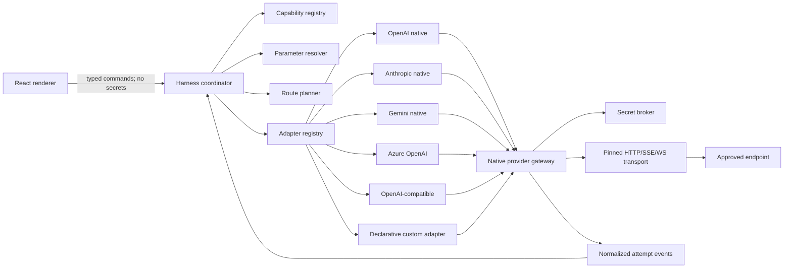

# Omnia provider and BYOK architecture

Status: proposed implementation contract  
Scope: Chat Complete provider transport, model catalog, capability negotiation, advanced controls, routing, and provider conformance  
Target runtime: the trusted Rust/Tauri core; the renderer never calls model providers directly

This document specializes the provider requirements in `PRODUCT_SPEC.md` and the provider SPI in `HARNESS_ARCHITECTURE.md`. It does not change the run state machine, storage trust boundary, or secret-store rules defined there.

## 1. Outcome and design constraints

Omnia needs one stable chat harness without flattening OpenAI, Anthropic, Gemini, Azure, local runtimes, and compatible gateways into the smallest common API. The solution is a canonical, loss-aware protocol owned by Omnia plus provider adapters that declare and prove what they can do.

The following invariants are release-blocking:

1. Provider credentials are resolved only inside the native transport boundary.
2. A parameter that the user explicitly set is sent with inspectable translation, deliberately emulated, or rejected before dispatch. It is never silently omitted.
3. The model and capability snapshot used for a run is immutable even if catalog data refreshes while the run is active.
4. Native capabilities remain accessible through validated, namespaced extensions.
5. Adapter code translates provider semantics. It does not choose user policy, permissions, fallback destinations, memory, skills, or context.
6. Provider events are normalized before they reach persistence or renderer IPC.
7. A retry, repair, resume, or fallback is a new attempt. No attempt overwrites another attempt's partial or final output.
8. Custom endpoints cannot turn remote metadata into executable code or secretly broaden network access.

## 2. Component boundaries



The provider subsystem should be a Rust workspace or clearly separated Rust modules even if Phase 0 keeps them in the Tauri crate:

```text
provider_core/        canonical types, registry, validation, errors
provider_transport/   egress gate, auth application, HTTP/SSE/WS, redaction
provider_catalog/     model discovery, cache, capability merge
provider_openai/      OpenAI Responses adapter
provider_anthropic/   Anthropic Messages adapter
provider_gemini/      Gemini generateContent adapter
provider_azure/       Azure endpoint/deployment mapping
provider_compat/      OpenAI Responses/Chat compatibility modes
provider_manifest/    declarative custom-adapter loader and validator
provider_mock/        deterministic conformance and fault-injection server
```

The React domain types are a serialized projection of native-owned contracts. TypeScript must not become an independent source of truth for authentication, transport, or provider validation.

## 3. Connection profiles

### 3.1 Connection record

A connection represents one account or endpoint, not a provider globally. Users may keep aliases such as Personal, Work, Local GPU, and Team Gateway.

```ts
interface ProviderConnectionProfile {
  schemaVersion: 1;
  id: string;
  adapterId: string;
  displayName: string;
  endpoint: {
    baseUrl: string;
    apiVersion?: string;
    deploymentMap?: Record<string, string>;
  };
  auth: ProviderAuthDescriptor;
  requestMetadata: {
    organizationId?: string;
    projectId?: string;
    staticHeaders: Record<string, string>;
    secretHeaderRefs: Record<string, string>;
    query: Record<string, string>;
  };
  transport: TransportPolicy;
  egressPolicy: ProviderEgressPolicy;
  retentionDisclosure?: string;
  enabled: boolean;
}
```

The persisted record contains only non-secret metadata and opaque vault handles. Static headers and query values are schema-checked against a denylist; anything secret-shaped must be stored as a secret reference. `Authorization`, cookies, API keys, signed URLs, passwords, tokens, and credentials never enter `config_json`.

### 3.2 Authentication strategies

Exactly one primary authentication strategy is active for a connection:

| Strategy | Use | Native behavior |
|---|---|---|
| `none` | Explicitly unauthenticated local server | Allowed only under the endpoint's egress grant |
| `bearer_secret` | OpenAI-compatible bearer token; Anthropic subscriber/OAuth token when the installed Messages adapter supports it | `Authorization: Bearer` applied at dispatch; Anthropic bearer requests also carry the required version/OAuth beta headers |
| `header_secret` | Anthropic `x-api-key`, Gemini, custom API-key headers | Adapter owns the fixed header name |
| `query_secret` | Compatibility-only APIs that require a key query parameter | Sensitive query is constructed after logging and never persisted as a URL |
| `azure_api_key` | Azure OpenAI API-key auth | Applied only to the pinned Azure origin |
| `oauth_refreshable` | Provider OAuth where Omnia has a supported public flow | Refresh token stays in the vault; access token is ephemeral |
| `command_bearer` | Enterprise credential helper | Trusted native process invokes an allowlisted executable with fixed args and no stdin; stdout is the token only |

Mutually exclusive credential sources prevent ambiguous precedence. A command credential has a timeout, refresh interval, output byte limit, sanitized environment, explicit executable path, and no shell interpolation. Command authentication is expert-only and is excluded from project-scoped configuration.

### 3.3 Transport policy

Recommended defaults, with provider templates allowed to tighten them:

```ts
interface TransportPolicy {
  connectTimeoutMs: number;       // default 10_000
  responseHeaderTimeoutMs: number;// default 30_000
  streamIdleTimeoutMs: number;    // default 300_000
  totalTimeoutMs?: number;        // unset for supported long/background runs
  requestMaxRetries: number;      // default 4, before response body commitment
  streamMaxReconnects: number;    // default 2, only with proven resume/retrieval
  maxResponseBytes: number;
  maxErrorBodyBytes: number;
  allowCompression: boolean;
  redirectMode: "error" | "same-origin";
  proxyProfileId?: string;
  tlsProfileId?: string;
}
```

Timeouts are separate because connection, headers, stream silence, and overall duration imply different failures. Redirects are off by default. A same-origin redirect may be allowed only after scheme/host/port comparison and must never relax the credential binding.

### 3.4 Connection onboarding state machine

```text
draft -> endpoint_validated -> credential_saved -> probing -> ready
                                             \-> degraded
                                             \-> failed
ready/degraded -> refreshing -> ready/degraded/failed
any non-deleted state -> disabled -> enabled
any state -> deleting -> deleted
```

The Test connection action performs bounded, progressively expensive checks:

1. Parse and normalize the endpoint without a credential.
2. Resolve DNS and enforce public/local/private/metadata-address policy for every resolved address.
3. Establish TLS and record only non-sensitive diagnostics.
4. Make the cheapest authenticated health or model-list request the adapter supports.
5. Optionally run an explicit, user-approved minimum-token inference probe when metadata is insufficient.
6. Save a redacted health result, capability provenance, rate-limit observations, and the exact probe version.

Connectivity success does not prove every model capability. The UI distinguishes connection health from model capability confidence.

## 4. Adapter families and Phase 1 support

| Adapter | Preferred wire API | Discovery | Important native preservation |
|---|---|---|---|
| OpenAI | Responses API over SSE; WebSocket only when advertised and tested | Native models endpoint plus curated metadata | developer instructions, reasoning, verbosity, structured output, tools, parallel calls, service tier, background/retrieval, usage and request IDs |
| Anthropic | Messages API over SSE | Native models endpoint when available, then signed static catalog | system blocks, content blocks, thinking controls, prompt caching, tool use/result blocks, stop reasons, usage/cache counters |
| Gemini | `generateContent` / `streamGenerateContent` | Native models endpoint | system instruction, multimodal parts, safety settings, response MIME/schema, function calls/responses, candidate and usage metadata |
| Azure OpenAI | Responses-compatible deployment endpoint | Deployment mapping entered or imported by user; discovery varies by account | API version, deployment-to-model mapping, Azure auth and request identifiers |
| OpenAI compatible | Explicit `responses`, `chat_completions`, or conservative `auto` mode | `/models` when supported plus user entries | only fields proven by a template/probe; endpoint-specific extensions remain namespaced |
| Local compatible | OpenAI-compatible mode with visible local-provider grant | `/models` and health endpoints | local/offline label, unknown pricing, conservative limits, server-specific tool/vision badges |
| Custom manifest | Declarative HTTP/SSE mapping | Manifest-declared list endpoint or manual entries | validated request/response mappings only; no arbitrary code in the main process |

OpenAI Chat Completions is a compatibility surface, not Omnia's canonical protocol. New first-party OpenAI work uses Responses semantics. Chat compatibility remains because many gateways and local servers expose it.

## 5. Adapter SPI

The high-level SPI in `HARNESS_ARCHITECTURE.md` should compile to a native contract with the following lifecycle:

```ts
interface ProviderAdapter {
  descriptor(): AdapterDescriptor;
  validateConnection(input: SecretRefConnection): Promise<ConnectionHealth>;
  discoverModels(input: DiscoveryInput): AsyncIterable<ModelCatalogEvent>;
  probeCapabilities(input: CapabilityProbeInput): Promise<CapabilitySnapshot>;
  validateRun(input: ProviderRunInput): Promise<ValidationResult>;
  estimateTokens(input: CanonicalModelInput): Promise<TokenEstimate>;
  translate(input: CanonicalModelInput): Promise<TranslatedRequest>;
  execute(input: TranslatedRequest, signal: AbortSignal): AsyncIterable<ProviderStreamEvent>;
  cancel?(handle: ProviderRequestHandle): Promise<CancelOutcome>;
  retrieve?(handle: ProviderRequestHandle, cursor?: string): AsyncIterable<ProviderStreamEvent>;
  classifyError(input: ProviderFailureInput): ProviderError;
}
```

Adapter methods have strict ownership:

- `descriptor` declares schemas and never performs I/O.
- `discoverModels` treats all remote fields as untrusted and bounded.
- `probeCapabilities` returns evidence; it cannot weaken policy.
- `validateRun` is pure with respect to billable inference and produces field-level errors.
- `translate` is deterministic for a frozen input and adapter version.
- `execute` receives a transport object, not raw secret bytes.
- `classifyError` must not inspect unbounded or unredacted response bodies.

The transport gateway, not an adapter, owns DNS resolution, address policy, TLS/proxy application, authentication materialization, redirects, byte/time limits, cancellation, redaction, and telemetry.

## 6. Canonical provider protocol

### 6.1 Canonical input

```ts
interface CanonicalModelInput {
  schemaVersion: 1;
  attemptId: string;
  model: FrozenModelSelection;
  instructions: InstructionLayer[];
  messages: CanonicalMessage[];
  tools: CanonicalToolDefinition[];
  responseContract?: ResponseContract;
  parameters: ResolvedParameterSet;
  contextSnapshotId: string;
  requestIdempotencyKey: string;
  dataClasses: string[];
  providerExtensions: Record<string, unknown>;
}
```

Content is block-oriented rather than string-only:

```ts
type CanonicalContent =
  | { type: "input_text"; text: string }
  | { type: "input_image"; blobRef: string; mediaType: string; detail?: string }
  | { type: "input_audio"; blobRef: string; mediaType: string }
  | { type: "input_file"; blobRef: string; mediaType: string; filename: string }
  | { type: "tool_call"; callId: string; toolName: string; argumentsJson: string }
  | { type: "tool_result"; callId: string; result: CanonicalContent[]; isError: boolean }
  | { type: "refusal"; text: string };
```

Adapters map roles and content blocks according to provider rules. Role coercion is recorded as a translation note. Impossible role/order combinations are rejected or repaired by a named, user-visible harness transform; they are not quietly rewritten.

### 6.2 Response contract

```ts
type ResponseContract =
  | { type: "text" }
  | { type: "json_object" }
  | { type: "json_schema"; name: string; schema: object; strict: boolean }
  | { type: "provider_native"; namespace: string; value: object };
```

Native strict structured output is preferred. JSON-prompt emulation is separately labeled `emulated`, includes validation/repair limits, and must not be presented as equivalent to provider-enforced schemas.

### 6.3 Normalized stream events

Provider parsers emit attempt-local events. The harness wraps them in the durable envelope and assigns global sequence numbers.

```ts
type ProviderStreamEvent =
  | { type: "response.started"; remoteRequestId?: string; remoteResponseId?: string }
  | { type: "item.started"; itemId: string; itemKind: string }
  | { type: "text.delta"; itemId: string; delta: string }
  | { type: "reasoning_summary.delta"; itemId: string; delta: string }
  | { type: "citation"; itemId: string; citation: CanonicalCitation }
  | { type: "tool_call.started"; itemId: string; callId: string; name: string }
  | { type: "tool_call.arguments_delta"; callId: string; delta: string }
  | { type: "tool_call.completed"; callId: string; argumentsJson: string }
  | { type: "item.completed"; itemId: string }
  | { type: "usage.updated"; usage: NormalizedUsage; authoritative: boolean }
  | { type: "rate_limit.updated"; limits: NormalizedRateLimit[] }
  | { type: "provider.warning"; code: string; message: string }
  | { type: "response.completed"; finishReason: NormalizedFinishReason }
  | { type: "response.failed"; error: ProviderError };
```

Rules:

- Text and tool-argument deltas may be arbitrarily fragmented, including inside UTF-8 boundaries at the wire layer. The adapter must decode incrementally and assemble valid text/JSON.
- Duplicate provider events are deduplicated only with a provider event ID or proven cursor. Content-based guessing is forbidden.
- Unknown event types are retained as bounded namespaced diagnostics and do not crash the stream.
- Reasoning summaries are user-visible only when the provider explicitly exposes a summary. Hidden chain-of-thought is neither requested through undocumented fields nor synthesized as if native.
- Final usage may replace provisional usage only when it is from the same remote response and marked authoritative.

### 6.4 Usage and cost

```ts
interface NormalizedUsage {
  inputTokens?: number;
  cachedInputTokens?: number;
  cacheWriteTokens?: number;
  outputTokens?: number;
  reasoningOutputTokens?: number;
  totalTokens?: number;
  providerUnits?: Record<string, number>;
}
```

Usage records include source (`provider_final`, `provider_incremental`, `local_estimate`, `unknown`) and raw namespaced counters. Estimated cost is computed from a versioned price snapshot, never from the current catalog after the run. Unknown pricing or usage remains unknown; zero is not used as a substitute.

### 6.5 Finish reasons

Common finish reasons are `stop`, `length`, `tool_calls`, `content_filter`, `refusal`, `cancelled`, `error`, and `unknown`. The raw provider reason is retained under a namespace. `content_filter` and `refusal` are semantic outcomes, not retryable transport errors.

## 7. Capability and model catalog

### 7.1 Capability states

Booleans alone are insufficient. Each capability has availability, support mode, limits, and evidence:

```ts
interface FeatureCapability<TLimits = unknown> {
  availability: "supported" | "unsupported" | "unknown";
  mode: "native" | "translated" | "emulated" | "none";
  limits?: TLimits;
  source: "provider_live" | "signed_static" | "adapter_static" | "user_descriptive" | "unknown";
  confidence: "verified" | "declared" | "inferred" | "unknown";
  observedAt: string;
  expiresAt?: string;
  evidence?: { probeId?: string; adapterVersion?: string; note?: string };
}
```

The existing domain `CapabilityValue<T>` is sufficient for initial metadata, but implementation should evolve toward this feature shape before adapters expose translated/emulated functionality.

Capability groups include:

- input/output modalities and upload modes;
- streaming, background execution, retrieval, and cancellation;
- roles/instruction hierarchy;
- tools, parallel tools, forced/required tool choice, strict tool schemas;
- JSON object/schema output and schema limits;
- reasoning effort/budget/summary controls;
- sampling and penalty parameters;
- prompt cache controls and usage accounting;
- log probabilities, citations, grounded search, image/audio generation;
- context/output limits and tokenizer confidence;
- transport options such as SSE/WebSocket and resume cursors.

### 7.2 Catalog merge precedence

Catalog sources merge field by field, not object by object:

```text
security-enforced adapter facts
  > verified live probe
  > provider live model metadata
  > signed/curated Omnia catalog
  > adapter static declaration
  > user descriptive override
  > unknown
```

A user may correct display name, context size, price, or descriptive badges with visible provenance. A user may not override auth, TLS, safety enforcement, tool side effects, redirect behavior, or endpoint grants.

Discovery cache entries have `observedAt`, `expiresAt`, adapter version, endpoint fingerprint, and a content hash. On refresh failure, Omnia may display stale entries with a badge and allow explicitly selected known models if the connection is otherwise usable. Stale data cannot silently enable a capability previously unknown.

### 7.3 OpenAI-compatible capability modes

`auto` is conservative discovery, not optimistic field spraying:

1. Identify known server fingerprints without trusting them for security.
2. Call model/health endpoints if allowed.
3. Match a bundled template only when endpoint family and response shape agree.
4. Perform non-billable probes where possible.
5. Offer an opt-in minimal inference probe for uncertain features.
6. Leave unproven features `unknown` and let the user add descriptive metadata.

Users can explicitly choose `Responses`, `Chat Completions`, or a known server template to avoid heuristic ambiguity.

## 8. Advanced parameter system

The UI is generated from the selected model's `ParameterCapability` schema. A normalized key exists only where semantics are close enough to document a stable transform. Otherwise the control is provider-native and namespaced.

### 8.1 Normalized keys

Phase 1 should support the following vocabulary where applicable:

```text
sampling.temperature
sampling.top_p
sampling.top_k
sampling.min_p
sampling.seed
sampling.frequency_penalty
sampling.presence_penalty
sampling.repetition_penalty
output.max_tokens
output.stop
output.candidates
output.verbosity
output.logprobs
reasoning.effort
reasoning.budget_tokens
reasoning.summary
tools.choice
tools.parallel
tools.max_iterations
response.contract
cache.mode
cache.key
cache.retention
service.tier
request.priority
request.background
request.timeout_ms
request.retry_policy
```

Provider-specific examples use names such as `openai.service_tier`, `anthropic.cache_control`, and `gemini.safety_settings`. The adapter registers a JSON Schema, UI hints, sensitivity classification, and conflicts for each extension. The raw `extra_body` escape hatch is disabled by default; developer mode can expose validated namespaces, never arbitrary headers, auth, URLs, or unknown top-level values.

### 8.2 Support modes

| Mode | Meaning | Inspector behavior |
|---|---|---|
| `native` | Provider directly implements the semantic | Show provider field and exact value |
| `translated` | Deterministic semantics-preserving mapping | Show source value, transform ID/version, destination field |
| `emulated` | Harness approximates through prompting, validation, or extra calls | Require explicit enablement and disclose cost/quality implications |
| `unsupported` | Cannot fulfill safely | Disable control; explicit stored value blocks dispatch |

Transforms are versioned functions with golden vectors. Examples: reasoning effort enum mapping, system/developer-role collapse, response token field rename, and tool-choice shape conversion. Approximate mappings are `emulated`, not `translated`.

### 8.3 Conflict validation

Parameter schemas express:

- numeric range, step, enum, nullability, and units;
- requires, conflicts, and mutually exclusive groups;
- model/transport/modality predicates;
- organization/provider hard bounds;
- default source and whether omission differs from an explicit value;
- determinism and caching implications;
- possible extra cost or latency.

Validation happens twice: when resolving layers and again immediately before translation against the frozen capability snapshot. A mismatch caused by stale discovery fails safely and suggests refresh; it does not drop the value.

## 9. Tool-call translation boundary

Although chat phases expose only permissioned chat-safe tools, provider adapters must support complete tool-call round trips from Phase 1.

Tool definitions use JSON Schema with stable Omnia tool IDs and provider-safe aliases. Adapters maintain a reversible alias map because providers differ in naming rules. Descriptions and schemas are size-bounded before dispatch.

The stream parser assembles arguments as an opaque string and validates JSON only at completion. The harness then:

1. resolves the alias to a registered immutable tool version;
2. parses JSON with depth, number, string, and total-size limits;
3. validates against the canonical schema;
4. checks permissions and approvals outside the adapter;
5. executes or rejects the call;
6. sends a canonical tool result on a new model iteration.

Provider `call_id` values are untrusted external IDs. They are mapped to internal IDs and length-limited. A model cannot invent a call ID that binds to another run or iteration.

## 10. Routing, fallback, and reliability

### 10.1 Route plan

Routing produces an inspectable immutable plan before dispatch:

```ts
interface RoutePlan {
  primary: RouteCandidate;
  fallbacks: RouteCandidate[];
  requiredCapabilities: string[];
  dataClasses: string[];
  localOnly: boolean;
  maxAttempts: number;
  maxEstimatedMicrounits?: number;
  latencyPreference?: "quality" | "balanced" | "fast";
  fallbackConsent: "never" | "same-connection" | "allowed-connections";
}
```

Auto-routing may score only eligible candidates. Eligibility is a hard gate over user provider allowlist, project policy, data class, modality, required native/emulated modes, context size, known model state, and cost ceiling. Quality/latency scoring happens afterward and is versioned in run provenance.

### 10.2 Retry classes

| Class | Examples | Automatic action |
|---|---|---|
| Local preflight | invalid role order, oversized schema, unsupported parameter | None; fix before dispatch |
| Definitely not accepted | DNS/TLS/connect failure before request commitment | Retry same route within budget |
| Explicit transient | 408, 409 when provider documents it, 429, selected 5xx | Respect `Retry-After`; exponential backoff with full jitter |
| Semantic client error | invalid request/auth/model/permission | Do not repeat unchanged |
| Partial stream, resumable | cursor/retrieve API available | Reattach/retrieve same remote response |
| Partial stream, non-resumable | tokens received but no resume contract | Preserve partial; do not auto-regenerate into same output |
| Acceptance unknown | connection drops after request commitment and no idempotency/retrieval proof | Mark unknown; require user decision |
| Refusal/filter | provider safety or model refusal | Terminal semantic outcome |

Retry budgets count attempts and wall time. Backoff is capped, cancellable, and visible. Rate-limit headers are parsed into normalized scopes/windows only when their semantics are known; raw bounded values remain namespaced.

An idempotency key is always generated, but it is considered effective only when the selected provider contract guarantees its meaning. The inspector says whether idempotency is `enforced`, `best_effort`, or `unsupported`.

### 10.3 Fallback rules

Automatic fallback is forbidden unless every destination connection was explicitly authorized for the run's data classes. Crossing from local to public, personal to work, or one provider to another is a visible route change. A fallback creates a new attempt and emits `attempt.fallback_proposed` or `attempt.fallback_selected` before any content is sent.

Fallback never occurs for auth errors, policy denials, content filters/refusals, invalid parameters, or after a successful provider completion. A provider/model change may alter quality, retention, price, or feature behavior, so the route plan records all compatibility losses before dispatch.

## 11. Errors and diagnostics

```ts
interface ProviderError {
  category:
    | "configuration" | "authentication" | "authorization" | "not_found"
    | "unsupported" | "invalid_request" | "rate_limited" | "overloaded"
    | "safety" | "timeout" | "network" | "protocol" | "cancelled"
    | "billing" | "unknown";
  code: string;
  message: string;
  retryability: "never" | "same_route" | "after_delay" | "resume_only" | "user_decision";
  acceptance: "not_sent" | "rejected" | "accepted" | "unknown";
  retryAfterMs?: number;
  remoteRequestId?: string;
  httpStatus?: number;
  fieldPath?: string;
  safeDetails: Record<string, unknown>;
}
```

User messages are actionable and redacted. Diagnostic mode may include HTTP status, timing stages, adapter/parser version, endpoint origin hash, request ID, event counts, and bounded redacted error fields. It never includes credentials, request bodies, output content by default, cookies, full URLs with query strings, or raw headers.

Provider payload retention is an explicit per-profile option. When enabled, it is encrypted, size/age bounded, labeled sensitive, excluded from exports by default, and scanned/redacted before display.

## 12. Custom adapter manifests

P0 custom adapters are declarative. A manifest can describe:

- adapter identity and manifest schema version;
- base/path templates whose host cannot escape the connection allowlist;
- a fixed set of supported auth placements;
- model-list pagination and bounded field extraction;
- JSON request templates using allowlisted canonical bindings;
- SSE/JSONL event selectors and finish/error/usage mappings;
- parameter schemas and deterministic field mappings;
- static capabilities and optional safe probe recipes;
- required Omnia version and feature flags.

A manifest cannot execute JavaScript/WASM/native code, invoke a shell, read arbitrary files/environment variables, define a new credential sink, disable TLS checks, follow arbitrary redirects, or expand the network allowlist. Unknown manifest fields are rejected for the current major schema.

Executable third-party provider plug-ins are deferred until there is a signed package model and out-of-process sandbox with a narrow RPC capability contract. They must never load into the renderer or main trusted process.

## 13. Persistence and provenance

The Phase 0 schema already separates `provider_profiles`, `provider_models`, and `generations`. Before live adapters ship, persistence should also be able to represent:

- adapter ID and adapter version per connection and attempt;
- catalog source/provenance, endpoint fingerprint, observed/expiry times;
- immutable capability snapshot hash per generation/attempt;
- one run-to-many-attempt records for retry/resume/fallback;
- remote response/request IDs separately from internal IDs;
- idempotency support state and key hash, never a secret-bearing key if the provider treats it as sensitive;
- normalized usage source and price snapshot/version;
- retry classification, acceptance state, route reason, and reconnect cursor;
- translation notes and transform versions;
- encrypted raw payload blob reference only when explicitly enabled.

No migration should repurpose the current `generations` row as an attempt if doing so loses the distinction between one user-visible run and multiple provider dispatches.

## 14. Implementation sequence

### Phase 0A — contracts and deterministic mock

1. Freeze JSON Schema for connection, adapter descriptor, capability snapshot, canonical input, provider event, usage, and error.
2. Generate Rust and TypeScript projections or round-trip fixtures from one schema source.
3. Build the adapter registry and deterministic mock adapter.
4. Add a scripted mock HTTP/SSE server that fragments bytes/events, delays stages, duplicates IDs, disconnects, sends malformed frames, and reports provisional/final usage.
5. Prove stop, partial persistence, cursor replay, and exactly-one-terminal-event invariants.

### Phase 0B — gateway and catalog

1. Implement endpoint normalization, DNS/IP policy, redirect denial, timeout/byte/decompression limits, proxy/TLS profiles, cancellation, and redaction.
2. Integrate the Windows-backed secret broker by opaque handle.
3. Implement connection onboarding, health states, catalog cache, provenance merge, and custom entries.
4. Build capability-driven controls using the mock adapter.

### Phase 1A — native provider adapters

Implement in this order because it exercises increasingly different semantics:

1. OpenAI Responses.
2. Anthropic Messages.
3. Gemini generateContent.
4. Azure OpenAI deployment mapping.
5. OpenAI-compatible Responses and Chat modes.
6. Known local templates and declarative custom manifests.

Each adapter ships only after it passes the shared conformance suite and an opt-in, budget-capped live smoke test.

### Phase 1B — reliability and expert controls

1. Provider-aware usage/cost and rate-limit display.
2. Structured output and tool-call round trips.
3. Resume/retrieve where contracts exist; conservative unknown-acceptance handling elsewhere.
4. Parameter layering, conflict schemas, native extension panels, and request preview.
5. Explicit route/fallback policy and compare fan-out.
6. Redacted provider diagnostics and replay bundles.

## 15. Conformance suite

Every adapter and manifest interpreter runs the same black-box suite.

### Connection and discovery

- invalid URL, embedded credential, forbidden scheme, private/metadata address, DNS rebinding, cross-origin redirect;
- missing/locked/replaced credential and auth retry without secret leakage;
- discovery pagination, duplicates, enormous fields/counts, invalid Unicode, stale cache, removed model;
- discovery success with inference denial and inference success with discovery denial;
- no model endpoint and a manual model entry.

### Translation

- every canonical role/content block and legal ordering;
- image/file limits, MIME mismatch, empty content, mixed modalities;
- exact normalized parameter vectors and all conflicts/bounds;
- provider-native extension schema rejection;
- structured JSON/schema output and schema-size/depth limits;
- tools, aliases, parallel calls, forced choices, argument limits, tool results;
- deterministic translation fingerprint for the same frozen inputs and versions.

### Streaming

- one byte per chunk, multiple events per chunk, CRLF/LF, split UTF-8, split JSON, comments/heartbeats;
- unknown events, duplicate identified events, out-of-order invalid events, missing terminal frame;
- interleaved text/reasoning/tool blocks and multiple candidates when supported;
- provisional/final usage and finish reason mapping;
- cancel before headers, before first token, during token, during tool args, after provider completion;
- renderer backpressure without loss of lifecycle/usage/tool events.

### Reliability

- connect failure, header timeout, idle timeout, total timeout, 429 with valid/invalid `Retry-After`, bounded 5xx;
- disconnect before and after request commitment;
- resumable and non-resumable partial streams;
- unknown acceptance never auto-duplicates;
- fallback denies an unapproved provider/data class and announces an approved route change;
- cost/attempt/wall-time budgets terminate predictably.

### Security and privacy

- credential absent from database, event log, trace, crash report, error, replay, clipboard, and renderer IPC;
- auth not forwarded on redirect or host change;
- malicious catalog/manifest fields render only as text and cannot alter routing;
- request/error decompression bombs and oversized frames terminate safely;
- custom manifest cannot create an undeclared host, secret sink, executable action, or raw extension escape;
- delete/replace connection deletes or rotates the correct vault handles and derived cache.

### Live smoke evidence

Live tests are opt-in and require explicit environment secrets, per-provider spending caps, minimum-output prompts, and automatic artifact redaction. They validate connection, model discovery, one streaming response, cancellation, usage, one structured-output case, and one tool-call case where supported. CI never requires paid credentials for ordinary development.

## 16. Initial decisions to capture as ADRs

1. Canonical schema source and Rust/TypeScript code-generation method.
2. Rust crate/module boundary between adapter, gateway, secret broker, and harness.
3. SSE parser and WebSocket transport libraries plus bounded-buffer strategy.
4. DNS rebinding protection and proxy interaction policy.
5. Manifest schema/signature/versioning policy.
6. Model catalog update/signing/distribution and pricing provenance.
7. Tokenizer plug-in strategy and conservative estimation margins.
8. Raw provider payload opt-in, encryption, retention, and diagnostic UX.
9. OAuth provider support boundary; BYOK API keys must not be confused with consumer ChatGPT/Claude/Gemini subscriptions.

## 17. Definition of done for Chat Complete provider support

A provider is not considered supported because one happy-path prompt returns text. It is supported only when:

- onboarding, secret storage, testing, discovery/manual model entry, and deletion work;
- capability/parameter UI matches the frozen model snapshot and never silently drops values;
- streaming, stop, errors, partial recovery, usage, and finish reasons normalize correctly;
- required multimodal, structured-output, and tool paths pass their declared support matrix;
- route destination, translation notes, attempts, request ID, token/cost confidence, and warnings are inspectable;
- security, fault-injection, offline mock, and live smoke evidence passes;
- unsupported and unknown behavior is as polished and truthful as success behavior.
