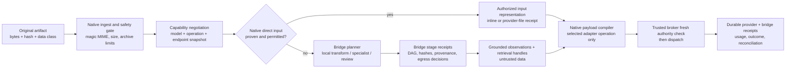

# Multimodal bridge and universal-endpoint red-team audit

## Outcome

Omnia has a sound **foundation for safe multimodal planning**, but it does not
yet have end-to-end multimodal dispatch, universal endpoint support, a local
model catalog/downloader, or a shipped specialist-persona execution catalog.
The current renderer deliberately blocks all attachment dispatch before a run
is prepared. The native provider gateway currently compiles text-only streams
for one OpenAI Chat Completions-shaped path, Anthropic Messages and Gemini
`streamGenerateContent`; it does not yet compile a typed attachment payload or
implement the claimed full endpoint families.

Therefore the correct product claim at this snapshot is:

> **Designed and partially unit-tested multimodal safety primitives; attachment
> dispatch is intentionally fail-closed. Universal endpoint, file bridge,
> local-runtime and specialist-persona capabilities remain planned until their
> native dispatch, recovery, UI and conformance evidence exist.**

“Support every endpoint” must mean a versioned, capability-probed adapter
platform able to onboard every approved operation a provider exposes. It cannot
truthfully mean that one static enum, one wire shape, or a provider brand label
makes all current and future endpoint methods available. A model, endpoint,
region, account tier, beta header, runtime version and uploaded-file mechanism
can each change the supported operation.

## Evidence inspected

| Area | Snapshot observation | Truthful status |
| --- | --- | --- |
| Renderer composer | `src/features/workspace/composer.tsx:138-142` rejects every draft attachment before run preparation. | Correct fail-closed behaviour; no attachment dispatch shipped. |
| Domain safety primitive | `src/domain/provider-multimodal.ts` creates a byte-free, immutable input plan; it validates frozen attachment scope, MIME/role/delivery limits, data classes, base64 expansion and keeps derived text untrusted. | Useful isolated foundation, not wired to native storage or provider payload generation. |
| Unit evidence | `npm run test -- src/domain/provider-multimodal.test.ts` passed: 1 file, 8 tests, on 2026-08-14. | Verifies only the TypeScript planner's bounded cases. |
| Native provider gateway | `src-tauri/src/provider_gateway.rs:856-872` selects only `chat/completions`, `messages`, or Gemini `streamGenerateContent`; builders accept `FrozenProviderMessage` text content. | Text-stream vertical slice only; not Responses, files, embeddings, native multimodal content blocks, local runtime protocols or every documented operation. |
| New target contracts | `architecture/multimodal-capability-bridge.md`, goal 21, bridge schema and persona schema describe the intended product. | Normative target, not native implementation evidence. |
| Local stack | `LOCAL_MODEL_READINESS_2026-08-14.md` found no verified runtime or model payload on the host. | Local routing/download/benchmark claims remain planned. |

The provider-multimodal unit test is worth preserving: it already proves the
right instinct that renderer data must never be trusted to claim a capability,
provide provider URLs, file bytes, paths, credentials or a different run's
attachment. The implementation should extend this boundary rather than replace
it with a renderer-side base64 uploader.

## External protocol research snapshot

This audit used current official documentation as an adapter-design input, not
as evidence that Omnia implements those providers. Provider behaviour must be
re-probed and captured in a dated snapshot at dispatch time.

- [OpenAI image and file inputs](https://platform.openai.com/docs/guides/images-vision)
  shows that input representation is API-specific: images can use URL, base64
  data URL or file reference, and file inputs have different processing paths.
- [Anthropic vision and document input](https://docs.anthropic.com/en/docs/build-with-claude/vision)
  documents typed content blocks and source representations that cannot safely
  be treated as OpenAI Chat Completions messages.
- [Google Gemini API file guidance](https://ai.google.dev/gemini-api/docs/files)
  shows separate file lifecycle and generation interactions, including a
  versioned API surface rather than one generic “chat endpoint.”
- [Ollama vision capability documentation](https://docs.ollama.com/capabilities/vision)
  documents native image handling, while its OpenAI-compatible surface is a
  separate compatibility contract.
- [LM Studio OpenAI compatibility documentation](https://lmstudio.ai/docs/developer/openai-compat)
  explicitly scopes compatibility to listed endpoints, which is why an
  OpenAI-shaped URL must never be presented as full OpenAI parity.
- [Hugging Face Hub model search API](https://huggingface.co/docs/huggingface_hub/package_reference/hf_api)
  and [snapshot download guidance](https://huggingface.co/docs/huggingface_hub/guides/download)
  support filtered catalog queries and revision-aware downloads, but source
  metadata is not a substitute for an on-host runtime probe or benchmark.

## Red-team findings

### P0-1 — Multimodal dispatch is correctly blocked, but no bridge can reach the provider

The composer refuses attachment dispatch, and `createProviderMultimodalPlan`
has no production call site outside its unit test. The Rust frozen input type
contains text messages, while the native gateway compiles only text payloads.

If UI copy, a model picker badge, or a documentation page implies that an image,
audio clip, PDF or Office file will be sent today, that would be a false claim.
Do not weaken the fail-closed guard until all of the following are atomic:

1. native-owned frozen attachment selection and immutable context binding;
2. provider/model/operation capability snapshot pinned before dispatch;
3. data-egress and approval check immediately before any upload or inline
   encoding;
4. exact provider payload compiler for the selected operation;
5. durable upload/dispatch/reconciliation receipts; and
6. UI that renders `native`, `bridged`, `blocked`, `unknown` and `failed`
   distinctly.

### P0-2 — A flat endpoint operation list plus a flat modality list creates false parity

`provider-endpoint-capability.schema.json` records `operations` and
`modalities` as unrelated arrays. A snapshot can therefore say it has
`responses`, `embeddings`, `files`, `images`, `audio`, `text` and `image`
without stating which model supports which operation, which direction of a
modality is supported, which MIME types are legal, or how the content must be
delivered. It also leaves `parameterSchemaId` optional.

This creates dangerous invalid inferences, for example:

- a provider has an image-generation endpoint, therefore its selected chat
  model can consume an image;
- a provider has Files, therefore a user file may be uploaded to every
  operation or reused across models;
- a local OpenAI-compatible server accepts `/v1/chat/completions`, therefore
  it accepts OpenAI Responses content blocks, audio, file IDs or all advanced
  parameters;
- an endpoint family has embeddings, therefore the model selected for chat is
  an embedding model.

Replace the two flat arrays with an `operationCapabilities` map keyed by a
stable operation ID. Each entry needs its model selector, input and output
modalities, content-block grammar, accepted MIME/wildcard policy, limits,
upload strategy, streaming and cancellation semantics, JSON/tool support,
parameter schema, beta/header requirements, rate-limit fields, idempotency
semantics, retention/locality constraints and probe evidence. A model profile
must reference one exact endpoint capability snapshot rather than reuse a
provider-family label.

### P0-3 — The bridge schema does not bind data egress or execution authority

`modality-bridge-plan.schema.json` names a destination model revision and
optional artifact data class, but does not require:

- destination provider profile and endpoint-capability snapshot;
- per-stage data locality/retention decision;
- an approval/grant/authority-continuity record;
- a user-visible egress decision for each original and derivative;
- allowed/denied recipient list, redaction result and policy reason; or
- a fresh broker evaluation immediately before an upload or remote specialist
  call.

This means a plan can appear local while a later `vision` stage sends a PDF,
frame, transcript or derivative to an incompatible remote provider. Make
`dataClass` a closed policy-backed type and require a per-stage
`DataEgressDecision` with `allowed`, `denied`, `review-required` and
`local-only` outcomes. Bind it to the current authority-continuity record;
historical plan lineage must not resurrect an expired grant, session, upload
handle or approval.

### P0-4 — The bridge schema conflates requested policy, resolved plan and execution receipt

`mode: "auto"` is persisted beside resolved paths such as `direct-native` and
`local-transform`. A stage can also be marked `running` or `completed` without
an attempt ID, idempotency key, output hash, result receipt, fault state,
checkpoint, operation owner or reconciliation result.

That permits a non-replayable plan: after a crash the system cannot establish
whether a provider upload or expensive specialist call was accepted, whether it
may safely retry, or what output a completed stage produced. It also makes
`Auto` explainable only in prose and subject to later routing drift.

Split the records:

| Record | Immutable purpose |
| --- | --- |
| `BridgeRequest` | User/policy intent: local-only, direct-only, budget, quality floor and manual/auto selection. |
| `CapabilityNegotiationDecision` | Pinned candidates, rejected alternatives, exact reason, score/evaluation version and resolved route. |
| `BridgePlan` | Dependency DAG of deterministic/specialist stages, all frozen model/tool/parameter/capability revisions. `resolvedMode` may never be `auto`. |
| `BridgeStageReceipt` | Attempt, input/output hashes, egress authorization, timing, usage/cost authority, idempotency, accepted/unknown/confirmed outcome and retry/reconciliation state. |
| `SurrogateObservation` | Source-linked observation with epistemic type and confidence; never a replacement for the original artifact. |

The planner may request `auto`; only the decision may resolve it. A persisted
bridge plan must contain a concrete route or `unsupported`/`review-required`.

### P0-5 — The bridge needs an explicit prompt-injection and provenance boundary

Files, OCR text, captions, code comments, web pages, EXIF, slide notes and
generated descriptions are **untrusted data**, not a source of system or user
instructions. The existing TypeScript primitive correctly forces extracted
attachment text to remain `untrusted_data`, but the target architecture/schema
does not yet make that invariant durable for every derivative and specialist
output.

Require every derived unit to carry:

- `authority: untrusted-data` unless it is an authenticated system/developer/
  user instruction created outside the artifact;
- an `observationKind`: `verbatim-extraction`, `ocr`, `transcript`,
  `measurement`, `model-observation`, `inference`, `summary`, or
  `hypothesis`;
- source region coordinates, source and output hash, transformer/model
  revision, prompt/template hash and confidence/calibration data;
- a policy that disables tool use, state changes, provider reconfiguration,
  secret access and authority escalation while processing untrusted content;
- a prompt-injection detector/result as a warning only, never as a reason to
  discard the original evidence silently.

The primary model must see a clear distinction between an original region, a
verbatim extraction and an inferred description. It may ask for a cited region
or another specialist pass; it must not receive a surrogate as if it were
native file comprehension.

### P0-6 — Native versus bridge truth is not yet enforceable at the payload boundary

The target documentation says a model that lacks a modality gets a bridge.
However, neither the target schema nor the current Rust frozen input captures a
typed native content block, uploaded file handle, provider upload TTL, source
selection, direct-versus-derived representation, provider request body hash or
model-operation compatibility proof.

The payload compiler must accept only an `AuthorizedInputRepresentation`:

- `native-inline` with canonical MIME, immutable blob handle and byte/encoded
  request budget;
- `native-provider-file` with provider file/upload receipt, expiry, content
  hash and profile/operation binding;
- `bridge-observation` with source-linked output and provenance; or
- `local-retrieval-handle` whose reads still pass the broker.

No adapter may accept an arbitrary renderer URL/base64 string or an unchecked
provider file ID. A provider file handle cannot cross account, profile, model,
endpoint or retention-policy scopes merely because it has the same textual ID.

### P0-7 — Persona prose is not an executable catalog or a safe bridge selector

Goal 21 and `specialist-agent-persona-catalog.md` list useful domains, but
there are no versioned role records to load, no stable catalog source, no typed
role input/output contract, no modality-to-role selection table and no bridge
stage reference to a chosen role/agent instance. `agent-role-profile.schema.json`
also omits several prose-mandated fields: budgets, stop/escalation conditions,
handoff packet, mandatory sources, sandbox policy and full input/output
contract.

Do not ship a menu that implies hundreds of available specialists until each
entry is a real signed/versioned record with a conservative capability ceiling.
For bridge stages, pin `specialistRoleProfileRevisionId`, agent instance,
model/adapter/capability snapshot, context manifest and evaluation rubric. A
persona name must never add tools, secret access or egress permission.

## P1 findings

### P1-1 — Endpoint support needs a declarative adapter registry, not a growing enum

The schema enum and current `ProviderFamily` enum cannot represent the user
request safely. New methods, beta headers, regional paths, asynchronous jobs,
webhooks, polling and runtime-specific local endpoints will otherwise require
core code edits and will drift from UI claims.

Use a signed/approved `ProviderAdapterManifest` for each adapter revision.
Manifest entries are explicit operation descriptors containing the safe base URL
rule, allowed origin policy, URI template, request/response schema, auth
injection strategy, paginated catalog semantics, upload lifecycle, stream
decoder, polling/webhook strategy, cancellation rule, error/retry mapping,
usage fields and conformance-fixture revision. A generic REST/SSE/WebSocket
adapter is allowed only after the manifest, sandbox and fixture suite pass.

The built-in adapters should be separately named and scoped, for example:

- OpenAI: Responses, Chat Completions, Embeddings, Files/uploads and only the
  other methods whose current adapter fixture/probe proves support;
- Anthropic: Messages, Models, token count, Files and Message Batches;
- Gemini: `v1` and `v1beta` generation/streaming/live, embeddings, token,
  files, batches and model discovery;
- local engines: Ollama native plus OpenAI compatibility, LM Studio native/
  OpenAI compatibility, llama.cpp, vLLM, TGI and approved embedding/rerank
  servers;
- custom/compatible endpoints: per-operation conformance, never a global
  “OpenAI compatible” or “Anthropic compatible” badge.

### P1-2 — Advanced parameter controls currently lack operation-level semantic proof

`model-profile.schema.json` offers a useful requested/effective effort shape,
but it forces four effort profiles even if a model lacks an equivalent and lets
`providerNative` be an unconstrained object. Neither it nor the provider
snapshot records operation-specific translation, unsupported reason,
precondition, source/effective value or redaction rule.

Parameter UX should be generated from the selected operation capability:

1. cross-provider intent is stored separately from protocol-native fields;
2. every exposed control has a JSON schema, UI metadata, valid range/default,
   feature gate and semantic translation rule;
3. an attempt journal records `requested`, `translated`, `effective`,
   `rejected`, `unavailable` or `provider-overrode` for every non-default;
4. raw expert JSON is schema-validated and redacted before persistence;
5. unsupported controls are unavailable before dispatch, not silently dropped.

### P1-3 — Local catalog query does not yet match its promised search/sort/filter semantics

`local-model-catalog-query.schema.json` includes basic source, task, modality,
format, quantization, license, size and memory filters. It does not preserve
per-source snapshot/cursor state, model/repository/revision/file hierarchy,
publisher trust, architecture/parameter/MoE/context details, language,
runtime/backend support, benchmark provenance, download/like freshness,
hardware-estimator version or stable sort tie-breakers.

Without an immutable source snapshot, a paginated Hugging Face/Ollama/LM Studio
view can duplicate or skip candidates when upstream metadata changes. Without a
file-level artifact manifest and a post-load probe, a repository tag must not
be shown as runtime-proven vision/audio/tool/embedding support. The local
catalog needs a `CatalogQueryReceipt` with source revisions, per-source cursors,
filter translation, result hashes, sort tie-breaker and observed-at/freshness.

### P1-4 — Download and local-fit claims need a supply-chain and measurement chain

The target workbench describes revision-pinned, resumable downloads and
hardware-aware recommendations, but no native download/import manager is
evidenced. A model recommendation must differentiate:

- metadata estimate versus measured load/prefill/decode/memory/thermal result;
- repository revision versus every downloaded file/blob hash;
- license metadata versus explicit user acceptance/gated access;
- a compatible file format versus a successful runtime load with the chosen
  backend; and
- `recommended`, `fits-with-tradeoffs`, `borderline`, `cpu-only`,
  `unsupported` and `unknown`.

The observed host has a 4 GiB-class GPU and about 16 GiB system memory, but no
verified local runtime/model payload. Recommendations must remain provisional
until a user-approved storage/runtime plan and role-specific benchmark receipts
exist. Never install a runtime, execute a model repository script, or fill the
system drive implicitly.

## Required architecture



### Required durable records

| Record | Must include |
| --- | --- |
| `ProviderAdapterManifest` | Adapter revision/signature, protocol family/version, operation descriptors, parser, URI/auth constraints, parameter schemas, fixture revision and allowed origins. |
| `EndpointCapabilitySnapshot` | Probe evidence/time/expiry, exact profile and endpoint identity, protocol/beta headers, operation-level capabilities, limits, data retention/locality, error/retry/idempotency and usage authority. |
| `ModelOperationCapability` | Exact model plus operation; accepted input/output modalities/MIME, content grammar, limits, tool/structured-output semantics, image/audio/video/file direction and availability reason. |
| `ArtifactVariant` / `ArtifactSpan` | Original/derivative hash, canonical MIME, safe inspection result, page/sheet/slide/frame/time/range coordinates, transform revision, retention and redaction state. |
| `DataEgressDecision` | Original/derivative IDs, source/destination locality, data classes, policy and authority revisions, grant/approval receipts, redaction result, user choice, expiry and broker decision. |
| `CapabilityNegotiationDecision` | Requested policy, candidates and rejections, model/operation snapshot, resolved concrete mode, scorer/evaluation revision, budget and confidence. |
| `BridgePlan` | Resolved dependency DAG only; no `auto` value; per-stage tool/model/role/parameters/capability snapshot, input/output contract, retry and quality gate. |
| `BridgeStageReceipt` | Attempt/idempotency, start/end, input/output hashes, cost/usage authority, provider acceptance, cancellation/checkpoint, outcome-unknown/reconciliation and evidence link. |
| `SurrogateObservation` | Observation kind, source spans, epistemic status, confidence/calibration, warnings, citations, output hash and untrusted-data authority. |
| `DispatchManifest` | Frozen `AuthorizedInputRepresentation`s, final adapter request revision, raw-body hash stored only in native secure storage, requested/effective parameters and full lineage. |

### Non-negotiable invariants

- A persisted plan has `requestedMode` and `resolvedMode`; `resolvedMode` is
  never `auto`.
- A bridge stage cannot run if its input hash, destination capability snapshot,
  current data-egress decision and authority check do not all match.
- One provider file/upload handle is bound to profile, endpoint operation,
  model scope, hash, TTL and retention policy. It is never a generic URL-like
  attachment token.
- Generated text from a file remains untrusted data. It cannot ask for tools,
  change routes, expose a secret or approve a network operation.
- A surrogate is a cited observation, not the original. The user can inspect
  the exact source region and choose direct/native, local-only, another bridge
  or no dispatch.
- An outcome-unknown upload, remote transform or generation job is reconciled
  before any duplicate-risk replay.
- “Compatible” is an operation-scoped evidence claim. A model picker must say
  `unknown`, `unavailable` or `partial` rather than infer capability from a
  brand, model name or GGUF repository tag.

## Atomic implementation programme

The following slices are intentionally small enough to schedule, test, review
and roll back independently. They are proposed IDs for the atomic requirement
registry; do not mark the umbrella goals verified merely because a document or
mock UI exists.

| Order | Proposed requirement/capability | Depends on | Done only when |
| --- | --- | --- | --- |
| 1 | `OMNIA-REQ-ADAPTER-MANIFEST-REGISTRY` | BYOK profiles | Signed/versioned adapter manifests, safe URI/auth rules, JSON schemas and fixture loader exist. |
| 2 | `OMNIA-REQ-ENDPOINT-OPERATION-CAPABILITY-SNAPSHOT` | 1 | Native probes persist dated/expiring operation-level endpoint/model capability snapshots; stale/unknown snapshots fail closed for binary input. |
| 3 | `OMNIA-REQ-ARTIFACT-INGEST-AND-VARIANT-LINEAGE` | workspace attachments | Native ingestion verifies MIME/magic, hashes, safe size/archive limits, originals and derivative lineage without renderer paths/bytes. |
| 4 | `OMNIA-REQ-MULTIMODAL-DATA-EGRESS-AUTHORITY` | 2, 3, approval broker | Every remote upload/stage has a fresh, policy-bound egress decision and no expired grant/session/secret inheritance. |
| 5 | `OMNIA-REQ-BRIDGE-PLAN-AND-STAGE-RECEIPTS` | 2, 3, 4 | Requested/resolved mode, typed DAG, idempotency, checkpoints, outcome-unknown reconciliation and immutable receipts survive restart. |
| 6 | `OMNIA-REQ-LOCAL-TRANSFORM-RUNNER` | 3, 5 | Sandboxed local render/extract/OCR/ASR/keyframe/table/archive/code transforms emit bounded, source-spanned variants and receipts. |
| 7 | `OMNIA-REQ-UNTRUSTED-ARTIFACT-INSTRUCTION-BOUNDARY` | 3, 5, 6 | Every artifact-derived text/observation is marked untrusted, provenance-bound and cannot alter authority, routing or tool scope. |
| 8 | `OMNIA-REQ-NATIVE-UPLOAD-AND-INPUT-REPRESENTATIONS` | 2, 3, 4, 5 | Native inline/provider-upload manager binds bytes/handles to the selected profile/operation/model/TTL and compiles only authorized representations. |
| 9 | `OMNIA-REQ-OPENAI-RESPONSES-AND-CHAT-CONFORMANCE` | 1, 2, 8 | Separate typed Responses and Chat adapters pass current golden fixtures for declared text/image/file/audio operations and reject unsupported fields. |
| 10 | `OMNIA-REQ-ANTHROPIC-MESSAGES-CONFORMANCE` | 1, 2, 8 | Typed Messages/content-block/file flows pass fixtures, token/model/file/batch operations are individually labeled, and beta headers are snapshot-bound. |
| 11 | `OMNIA-REQ-GEMINI-V1-V1BETA-CONFORMANCE` | 1, 2, 8 | `v1`/`v1beta` generation/stream/live/file/embedding/token/batch/model methods are separate operations with exact version/path semantics. |
| 12 | `OMNIA-REQ-EMBEDDING-RERANK-OPERATION-ADAPTERS` | 1, 2 | Embedding/rerank inputs, dimensions, batching, normalization, usage and persistent vector provenance are explicit and tested. |
| 13 | `OMNIA-REQ-LOCAL-RUNTIME-ADAPTER-CONFORMANCE` | 1, 2, 8 | Ollama native/OpenAI compatibility, LM Studio compatibility/native interfaces, llama.cpp, vLLM and TGI are proven per operation, never one global compatibility badge. |
| 14 | `OMNIA-REQ-HF_OLLAMA_LMSTUDIO-CATALOG-SNAPSHOTS` | local model registry | Catalog adapters preserve source revision/cursor/filter translation/sort tie-breaker/freshness and expose model-versus-file hierarchy. |
| 15 | `OMNIA-REQ-LOCAL-MODEL-DOWNLOAD-INTEGRITY` | 14, approval broker | User-approved resumable revision-pinned download/import, license/gating, per-file hashes, quarantine, atomic promote, storage selection and removal receipts work. |
| 16 | `OMNIA-REQ-HARDWARE-FIT-AND-LOCAL-BENCHMARKS` | 13, 15 | Estimator version and measured role/runtime/quantization benchmarks produce evidence-backed fit classifications without optimistic claims. |
| 17 | `OMNIA-REQ-SPECIALIST-PERSONA-RECORDS` | agent lifecycle/authority | A real versioned built-in catalog covers the requested roles with input/output, tool/context/authority ceiling, budget, stop/handoff and evaluation contracts. |
| 18 | `OMNIA-REQ-MODALITY-TO-SPECIALIST-ROUTING` | 5, 7, 17 | Bridge planner can select/pin a permitted specialist role, model and evaluation rubric; agents never gain new privileges from a persona. |
| 19 | `OMNIA-REQ-MULTIMODAL-INSPECTOR-AND-USER-CONTROLS` | 5, 8, 18 | UI shows direct/bridged/local/review/blocked state, source spans, egress, alternatives, requested/effective parameters, cost/confidence and keep/delete choices accessibly. |
| 20 | `OMNIA-REQ-MULTIMODAL-CONFORMANCE-EVALUATION` | 6-19 | Representative native-vs-bridge, privacy, recovery, quality and provider/runtime fixtures run in CI and feed the capability ledger. |

## Required red-team acceptance matrix

| Scenario | Expected safe behaviour |
| --- | --- |
| Image model mismatch | `vision: false` or stale capability cannot result in direct upload; planner offers permitted bridge/local/review or blocks. |
| Scanned sensitive PDF | Render/OCR happens locally when policy requires; no remote derivative egress without a fresh compatible decision and visible approval. |
| Office file with prompt injection | Original and extraction remain untrusted data; content cannot change model, tool, secret, approval or continuation state. |
| Archive bomb/path traversal | Ingestion and bridge stop before extraction exceeds file/count/ratio/path limits; original remains quarantined with an inspectable failure. |
| Provider upload accepted then connection drops | Receipt is `outcome-unknown`; no automatic re-upload or billable retry until status/idempotency reconciliation. |
| Bridge crash after page 37 of 200 | Checkpoint/receipts allow idempotent resume; no duplicate remote specialist stages and no unverified page coverage claim. |
| Bridge describes an image inaccurately | Output carries inference/confidence/source regions; user can compare/re-run another specialist; primary model does not treat it as native pixels. |
| Local endpoint claims OpenAI compatibility | Only probed, fixture-backed operations are enabled; a chat-completions success never enables Responses, embeddings, files or image input by implication. |
| Advanced control differs by provider | UI shows translated/effective/unavailable state; rejected parameters cannot silently change generation semantics. |
| HF catalog changes during paging | Result receipt retains source snapshot/cursor/tie-breaker; UI reports refresh/staleness rather than silently duplicate/omit models. |
| Model download has no verified hash/license | Artifact remains quarantined/not runnable; no runtime installation or auto-execution occurs. |
| Persona handles cyber/science/document task | Role is chosen from a versioned ceiling-bound record; input is scoped, actions remain broker-approved and evidence rubric is attached. |

## Integration notes for the spec pack

At this audit snapshot, `validate-spec.ps1` correctly reports that the new
multimodal architecture/goal/persona/schema files are not all registered in
`manifest.allFiles`, and goals 20/21 do not yet have atomic requirement
mappings. This is an integration-state observation during concurrent work, not
a claim that the new contracts are invalid. Before a final green validation:

1. register the architecture, goal, harness and schema documents in the
   manifest and relevant reading routes;
2. add the atomic requirements/capabilities/acceptance rows above (or an
   approved equivalent) and align every goal's registry revision;
3. add all new schemas to the linked capability rows;
4. make `modality-bridge-plan` a graph/receipt contract rather than a loose
   status list; and
5. rerun the spec validator, focused TypeScript/Rust tests, and Project Twin
   generation only after the shared registry settles.

## Verification performed in this audit

```powershell
cd C:\Users\khang\source\repos\Omnia

npm run test -- src/domain/provider-multimodal.test.ts
# PASS: 1 test file, 8 tests

docs\omnia-ultra\tools\validate-spec.ps1
# Snapshot failure: new multimodal/persona files absent from manifest and
# goal/20 + goal/21 lack atomic requirement mappings while integration is active.
```

This audit does not assert that native attachment dispatch, OpenAI Responses,
Embeddings, Anthropic Files/Batches, Gemini `v1`/`v1beta`, Ollama, LM Studio,
Hugging Face download, local inference, full advanced parameter control or the
persona catalog has shipped. Those remain target work until the atomic evidence
above is implemented and verified.
