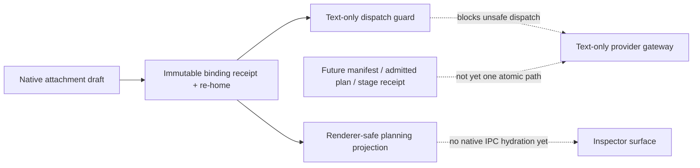

# Native multimodal admission evidence plan

Date: 2026-08-15  
Status: operational documentation plan; **not** implementation or runtime proof

## Purpose

This plan prevents the native multimodal work from being documented as either
less mature than its durable groundwork or more mature than its actual
end-to-end provider path. It defines the evidence required before publishing
`NATIVE_MULTIMODAL_ADMISSION_VERTICAL_SLICE_2026-08-15.md` and synchronizing
the current-state, capability-coverage, and Project Twin projections.

The target is a narrow **internal pre-bridge foundation**. It is not the broad
Omnia Ultra multimodal product capability and it must not be promoted to an
attachment-send, file-upload, provider-native, or local-transform claim merely
because a schema, a plan record, or an inspector component exists.

## Claim taxonomy

| Claim | May be made only when the listed evidence exists | Must never be inferred from it |
| --- | --- | --- |
| Native attachment provenance foundation | Exact native storage tests prove draft validation, immutable binding receipts, re-home lineage, and rollback; source review confirms the runtime boundary is native-only. | Provider upload, model acceptance, billable use, OCR/extraction, or rendering. |
| Text-only dispatch fail-closed | A prepared attempt with bound attachments is rejected by both frozen-input loading and dispatch transition tests. | That an attached prompt can be sent through the current gateway. |
| Immutable planning records | Schema v9 migration and bridge plan/stage receipt tests pass. | That a route was executed, uploaded, accepted, or eligible for current dispatch. |
| Renderer-safe bridge projection | Projection and inspector tests prove redaction/truthfulness rules for a native-owned payload. | Native IPC hydration, restart synchronization, interactive controls, or a live end-user bridge journey. |
| End-to-end multimodal dispatch | A carrier-specific adapter, fresh capability/policy/approval evaluation, provider-stage receipt, reconciliation path, and native-to-renderer synchronization are all demonstrated together. | Nothing; this is deliberately outside the present checkpoint. |

## Current intended checkpoint

At publication time, the evidence receipt may use only the following wording
unless later tests demonstrate more:

> Omnia contains an internal native attachment-binding and pre-bridge
> persistence foundation. It preserves immutable draft-to-message/run/blob
> provenance and blocks the text-only gateway from silently discarding bound
> attachments. The current public renderer/IPC path remains text-only and
> fail-closed for attachment dispatch.

The receipt must explicitly say that the following are still absent whenever
they remain absent in the same source snapshot:

- a native-derived deterministic source manifest built from
  `attachment_binding_receipts -> attachments -> blob_objects`;
- one transaction that joins binding, manifest construction, trusted route
  planning, plan/stage receipt persistence, and journal pointer creation;
- metadata-only native bridge-state read/subscribe IPC and restart hydration;
- isolated local transform/specialist execution;
- provider-native attachment carrier translation, upload/job dispatch, or a
  durable `approved-provider` acceptance receipt;
- reconciliation for a multimodal provider stage with an unknown external
  outcome; and
- an enabled end-user attachment submission path.

## Publication prerequisites

### 1. Capture one coherent source snapshot

Before describing any test result, record the exact snapshot used by the
receipt. The working tree may be intentionally uncommitted, so the receipt
must include either a source revision or hashes for the authoritative files.

Minimum source set:

```text
src-tauri/src/storage.rs
src-tauri/src/multimodal_bridge.rs
src-tauri/src/native_commands.rs
src-tauri/src/native_test_harness.rs
src/lib/desktop.ts
src/domain/multimodal-bridge.ts
src/features/workspace/multimodal-bridge-projection.ts
src/features/workspace/multimodal-bridge-inspector.tsx
src/features/workspace/composer-attachments.tsx
src/features/workspace/composer-attachment-boundary.test.tsx
```

The source snapshot is a claim boundary. Do not attach older successful test
output to files changed after that output was generated.

### 2. Native compile and migration evidence

The receipt must retain literal output and exit codes for:

```powershell
cargo fmt --manifest-path src-tauri\Cargo.toml --all --check

$env:CARGO_TARGET_DIR = 'C:\Users\khang\AppData\Local\OmniaGoalResume\target-run-telemetry-read'
cargo check --manifest-path src-tauri\Cargo.toml --all-targets --message-format=short
```

Then run the explicit `omnia_native` target rather than `cargo test --lib` on
this Windows environment. The receipt must list each exact test and its actual
result:

```powershell
cargo test --manifest-path src-tauri\Cargo.toml --test omnia_native `
  storage::tests::v8_profiles_migrate_to_v9_without_losing_telemetry_or_integrity `
  -- --nocapture

cargo test --manifest-path src-tauri\Cargo.toml --test omnia_native `
  storage::tests::attachment_draft_admission_binds_immutable_receipts_and_blocks_text_only_dispatch `
  -- --nocapture

cargo test --manifest-path src-tauri\Cargo.toml --test omnia_native `
  storage::tests::attachment_draft_admission_rejects_scope_or_expiry_without_partial_run_state `
  -- --nocapture

cargo test --manifest-path src-tauri\Cargo.toml --test omnia_native `
  native_commands::tests::text_only_prepare_ipc_rejects_attachment_draft_ids_until_bridge_admission_exists `
  -- --nocapture

cargo test --manifest-path src-tauri\Cargo.toml --test omnia_native `
  multimodal_bridge::tests::bridge_plan_and_stage_receipts_are_immutable_and_provenance_bound `
  -- --nocapture

cargo test --manifest-path src-tauri\Cargo.toml --test omnia_native `
  multimodal_bridge::tests::bridge_plan_rejects_paths_unapproved_egress_and_unknown_replay `
  -- --nocapture
```

If disk pressure, loader failure, or a compile error prevents a named test from
running, record that outcome exactly. A successful `cargo check` is useful
source evidence but is not replacement runtime evidence for a native test.

### 3. Renderer and domain evidence

Record exact output for:

```powershell
npm run typecheck

npm run test -- `
  src/domain/multimodal-bridge.test.ts `
  src/domain/provider-multimodal.test.ts `
  src/features/workspace/prepared-run-composer.test.tsx `
  src/features/workspace/composer-attachment-boundary.test.tsx `
  src/features/workspace/composer-attachments.test.tsx `
  src/features/workspace/multimodal-bridge-projection.test.ts `
  src/features/workspace/multimodal-bridge-inspector.test.tsx `
  --reporter=dot
```

Optional aggregate gates such as `npm run test -- --reporter=dot`, `npm run
build`, `npm run check:bundle`, `npm run check:typography`, and `npm run
check:hit-targets` should be reported separately. Their success improves
release confidence but does not supply a native attachment/provider proof.

### 4. Documentation and Project Twin evidence

Run documentation and generated-artifact checks only after source and registry
writers have stopped:

```powershell
docs\omnia-ultra\tools\validate-spec.ps1
npm run twin:bootstrap
npm run twin:check
```

If the spec validator succeeds before a source implementation is verified, it
proves pack consistency only. It must not be presented as evidence that a
provider supports a modality or that a file was delivered.

## Required receipt structure

The dated vertical-slice receipt should contain these sections in order:

1. **Verdict and scope** — state `partial / internal pre-bridge foundation`,
   not `complete` or `end-to-end`.
2. **Durable native facts** — schema version, migration, immutable receipt,
   re-home, guard, and any bridge plan/stage primitive actually proven.
3. **Authority and data-boundary map** — native storage is authoritative;
   renderer uses opaque IDs/metadata only; provider gateway remains text-only.
4. **Test evidence table** — command, test name, source snapshot, exit code,
   actual result, and what the result does *not* prove.
5. **Renderer truthfulness evidence** — no raw bytes/paths/credentials,
   no provider acceptance inferred from a plan, no blind retry after
   `outcome-unknown`.
6. **Non-claims / blockers** — enumerate every absent bridge stage listed in
   the current intended checkpoint.
7. **Next dependency-ready slice** — deterministic source manifest and one
   native admission transaction, followed by IPC projection only after that
   path has durable evidence.

## Required synchronized documentation changes

Once all preconditions pass, update these files in the same source snapshot:

| File | Required update | Boundary that must remain visible |
| --- | --- | --- |
| `docs/audit/NATIVE_MULTIMODAL_ADMISSION_VERTICAL_SLICE_2026-08-15.md` | New dated evidence receipt using the structure above. | No file upload/acceptance/execution claim without a later provider-stage receipt. |
| `docs/IMPLEMENTATION_STATUS.md` | Change the `Attachments and extraction` row from a blanket `Planned` statement to `Partial (native pre-bridge foundation)` only if the focused native runtime tests pass. Mention drafts, immutable binding receipts/re-home and text-only guard. | No OCR, extraction, carrier, provider upload, complete end-user attachment send, or in-app viewer/editor claim. |
| `docs/omnia-ultra/04-CURRENT-STATE-BRIDGE.md` | Replace the old “next slice” paragraph with a checkpoint that says the groundwork is complete only to the tested internal boundary, then name the remaining atomic admission route/manifest/IPC/executor dependencies. | Do not say bridge dispatch is current merely because its storage tables exist. |
| `docs/omnia-ultra/delivery/capability-coverage.md` | Add/update a human-readable row for `OMNIA-CAP-MULTIMODAL-CAPABILITY-BRIDGE` as `Partial` only when its matching ledger row is updated; cite the new receipt and focused tests. | The broad target still requires all modalities, transforms, fidelity, privacy, recovery, and truthfulness gates. |
| `docs/omnia-ultra/delivery/capability-ledger.json` | Update `OMNIA-CAP-MULTIMODAL-CAPABILITY-BRIDGE` from `planned` to `partial` only with exact modules/tests/evidence and an explicit remaining-gap description. Consider the narrower file-artifact row separately; do not mark either `verified`. | A capability row's `partial` status is current implementation truth, whereas a requirement `targetStatus` remains terminal intent. |
| `docs/project-twin/catalog.json` | Add/update a partial native pre-bridge architecture/component node, evidence IDs, and edges to storage, the text-only dispatch guard, and the renderer-safe projection. | Keep it distinct from provider gateway execution and do not create a false `provider-delivery` edge. |
| generated `docs/project-twin/*` | Regenerate only through `npm run twin:bootstrap`, then verify with `npm run twin:check`. | Generated atlas is a projection of cited facts, not an independent implementation proof. |

## Project Twin minimum model

The Project Twin update should model at least this truthful relationship:



The dashed edges are limitations, not delivery edges. The catalog description
must make that distinction accessible in text as well as visually.

## Release and safety rules

- Never enable or describe public attachment dispatch until a specific adapter
  has a frozen manifest/carrier contract, fresh policy/capability/approval
  evaluation, durable provider-stage receipt, and reconciliation behavior.
- Never use a `direct-native` route label, a plan hash, a generic MIME type, or
  a model name as evidence that a provider accepted a file.
- Keep output data, OCR/transcript/metadata, and derived descriptions
  untrusted for control purposes; they do not grant egress, tools, approvals,
  or secrets.
- Treat `outcome-unknown` as a reconciliation state. It is not a provider
  rejection and cannot justify a blind retry.
- Keep the current renderer IPC text-only until native exposes a separately
  designed metadata-only bridge operation. Do not re-add attachment draft IDs
  to text-only IPC merely to make a UI affordance appear functional.

## Completion criterion for this documentation plan

This plan is complete when the receipt and all synchronized projections cite
one verified source snapshot and each statement is traceable to a real test,
source fact, or explicit unimplemented boundary. The broader multimodal
capability remains incomplete until its own acceptance gates are satisfied.
