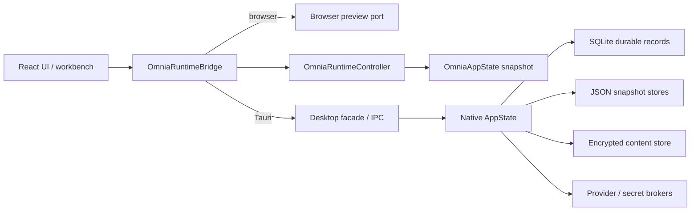
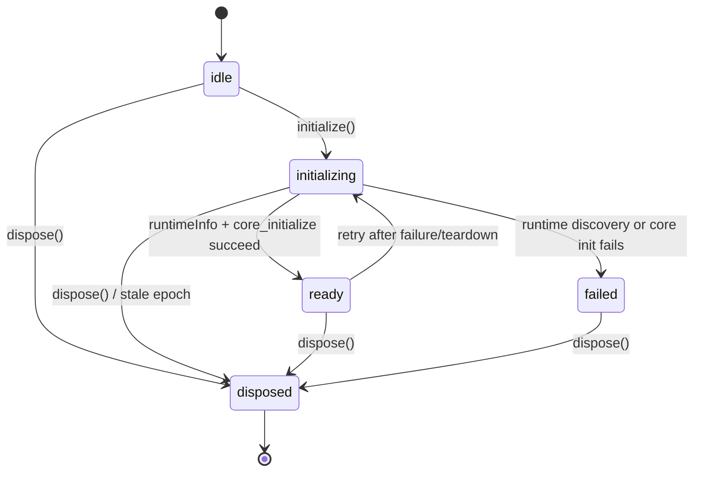
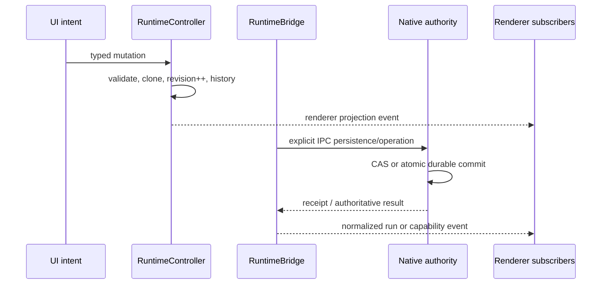
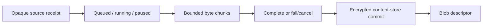

# Runtime composition and lifecycle

This document records the current runtime composition boundary for the moving
Omnia tree. It is an implementation companion to the normative target
architecture, not a claim that every native capability is packaged or verified.
The evidence vocabulary remains deliberate:

- **Implemented** means the source contract and its automated coverage exist.
- **Partial** means a meaningful native or renderer path exists, but a required
  integration, restart, security, or packaging gate is still open.
- **Preview** means the behavior is renderer-local or deterministic rehearsal.
- **Verified** requires the applicable native, recovery, security, and package
  evidence in `QA_STRATEGY.md`; source inspection alone is insufficient.

## Composition root

The renderer composition root is `OmniaAppState`. It is a JSON-safe, versioned
domain value containing chat, permissions, provider profiles, plugin
registrations, feature flags, projects, editor state, media queue, agent
scheduler state, automation definitions/runs, and the renderer event log. The
state shape is intentionally independent of its host: a browser preview can
hydrate the same domain value without receiving native authority.

`OmniaRuntimeController` owns renderer-side state transitions. Its transaction
boundary clones and validates the next state, increments the app revision,
records bounded history for undo/redo, and emits a renderer event containing a
defensive snapshot. It also exposes JSON state import/export and detached
transfer-bundle import/export. A controller event is a consequence of a
committed renderer transition; it is not proof that SQLite, a provider, or an
operating-system capability changed.

`OmniaRuntimeBridge` owns host negotiation and lifecycle. It does not become a
second state store and it does not silently persist browser state. The bridge
delegates desktop calls to `src/lib/desktop.ts` and uses an explicit in-memory
port for browser preview/tests.

The native `AppState` is the host-owned authority boundary. It currently owns
SQLite storage, the app-state snapshot store, a separate settings/permissions
snapshot store, secret and blob-key brokers, encrypted content storage,
download lifecycle state, attachment ownership, isolated-input leases, and the
provider gateway. The presence of a native command or Rust module establishes
an interface and validation surface; it does not by itself establish packaged
desktop behavior.

## Startup and disposal

Initialization is a single-flight negotiation with a lifecycle epoch:

The bridge performs these steps in order:

1. Discover `AppRuntimeInfo` and derive `browser` versus `desktop` mode.
2. Negotiate `CoreRuntimeInfo`, including protocol version and capability
   lists.
3. Publish `ready` only after both calls succeed.
4. Allow run-event subscription only for the current lifecycle epoch.
5. On disposal, invalidate the epoch, ignore stale asynchronous callbacks,
   and await all active subscription cleanups.

Capability lookup is tri-state. Before successful negotiation a capability is
`unknown`, not optimistically available or denied. The browser port advertises
only renderer-safe preview capabilities and explicitly marks replay cursors,
memory writes, workspace writes, process execution, browser control, and
computer control unavailable.

Initialization failure is fail-closed. Errors carry a typed code, retryability,
and an optional redacted diagnostic ID. A later initialization may retry after
a failure, while a disposed bridge cannot be revived.

## Mutation, persistence, and event ordering

The intended ordering is a domain transaction first, followed by the authority
that can durably commit it. Renderer notifications are projections of facts,
not commands to native storage:

The exact ordering differs by feature. A controller-only browser preview can
emit a local event without a native commit. A native provider run or durable
record must instead be accepted by the native transaction and journal path.
Consumers must therefore keep `state`, `receipt`, and `event` concepts
separate, and must not infer durable success from an optimistic UI update.

## App-state snapshots and detached transfer

`OmniaAppState` uses envelope version `1`. Hydration accepts the short-lived
version-0 envelope through explicit migrations, restores domains introduced
later (feature flags, automation, and event log), then delegates strict nested
validation to each domain parser. Future versions are rejected rather than
silently downgraded.

The native app-state store (`app_state_persistence.rs`) is deliberately small:

- snapshots are UTF-8 JSON objects bounded to 16 MiB;
- top-level revisions are positive integers;
- `expected_revision` provides compare-and-swap conflict detection;
- writes are staged through a scoped temporary file and replacement so a
  partially written JSON document is never committed; on Windows, the current
  replacement fallback may briefly leave the target absent while the exact
  replacement is completed;
- load/save operations return opaque receipt IDs;
- malformed, oversized, or invalidly encoded files fail closed.

The durable SQLite database remains authoritative for native conversations,
provider facts, run journals, and other relational records. The renderer
snapshot is a composition boundary, not a replacement for that database.

Transfer bundles are detached portable envelopes. Native export/import validates
bounded UTF-8 JSON and returns an owned bundle plus a receipt; it does **not**
merge the bundle into SQLite or write it into the app-state snapshot. The domain
adapter must apply an explicit merge policy, revision check, and redaction
policy. Secrets, credential bytes, raw provider headers, and browser cookies do
not belong in a transfer bundle.

## Separate policy persistence

Settings and permissions use a separate bounded JSON store so a policy write
cannot overwrite chat or project state. The store has its own top-level
revision/CAS contract, atomic replacement, malformed/oversized snapshot
rejection, and adapter-level error mapping. The renderer adapter uses the native
store in Tauri and an in-memory implementation in browser preview.

The existing Settings UI is still a preview/session surface unless a specific
control is explicitly wired to this adapter. A policy draft, feature flag, or
plugin manifest is not an authority grant; native capability checks remain the
source of truth.

## Download, blob, and attachment boundaries

The download manager is a native broker-fed lifecycle foundation, not a claim
of a complete browser download product:

Only an opaque source receipt ID, bounded filename/media type, and bounded byte
chunks cross into the native queue. Raw URLs, cookies, authorization headers,
and browser response handles stay with the broker. The current limits are a
64 MiB job and 1 MiB chunk, with explicit lifecycle transitions and content
store publication/deduplication. In-memory queue state is not yet equivalent
to restart-durable download resumption or a complete attachment UX.

Attachment drafts and native blobs have an admission boundary: ownership,
immutable binding, source-manifest construction, and text-only fail-closed
dispatch guards are present. Provider carrier/upload, OCR/PDF/DOCX extraction,
renderer hydration, and enabled attachment send UI remain separate gates.

## Scoped isolated input and capture

`isolated_input.rs` defines a capability and lease contract for target-scoped
input/capture. A request names an opaque target reference, target kind, visible,
unfocused, or headless mode, an explicit authorization receipt, requested
capabilities, and a bounded lease. Sessions and channels expire or stop
fail-closed, and event payloads are finite, bounded, and duplicate-free.

The current backend is `none`: capability receipts report every detached input,
cursor-overlay, frame-capture, unfocused-capture, and headless-capture capability
as unavailable, and create/attach/send operations reject with
`unsupported_capability`. This is a lifecycle/security contract, not proof of
active OS input injection or capture.

The design explicitly excludes global hooks, arbitrary desktop pointer
ownership, credential capture, CAPTCHA/DRM bypass, stealth automation, and
unscoped process/window targeting.

## Workspace indexing and retrieval

Workspace access begins with a read-only folder grant. Native indexing applies
path containment, reparse/sensitive-file skips, bounded file/byte/token/depth
limits, and deterministic lexical/MMR retrieval. Browser wrappers fail closed
when native authority is unavailable.

The current `workspace_index_build` command returns a complete
`WorkspaceIndexSnapshot`, and `workspace_index_retrieve` consumes that bounded
snapshot. The command path does not yet establish durable SQL index-table
persistence, watcher-driven invalidation, or a persisted retrieval cache. It
must therefore be described as a native bounded retrieval foundation, not as a
complete persistent Project Index.

## Scheduler, automation, plugins, and flags

The renderer/domain layer now has deterministic contracts for agent jobs,
dependency readiness, leases, retries, cancellation, automation definitions and
runs, plugin registration/lifecycle, and feature-flag evaluation. The runtime
controller includes these domains in the app-state transaction/history/event
boundary.

Those contracts do not authorize native workers, provider dispatch, worktree
mutation, durable leases/mailboxes, or process capabilities. Plugin manifests
describe requested metadata only; they do not grant process or filesystem
access. Feature flags select configuration and rollout state; they never grant
privileged behavior. Native policy and explicit capability gates must evaluate
any future activation.

## Evidence and release boundary

The following claims remain intentionally separate:

| Surface | Current classification | What is still required for `Verified` |
|---|---|---|
| Runtime bridge/controller | Implemented renderer contract; native boundary partial | Same-snapshot native compile, packaged startup, reconnect/replay, and desktop lifecycle evidence |
| App-state and transfer stores | Partial native foundation | Migration, crash/replace, recovery, redaction, close/reopen, and packaged IPC evidence |
| Settings/permissions adapter | Partial | Native UI hydration/save wiring, restart proof, policy-revision recovery, and packaged evidence |
| Download/content store | Partial native lifecycle | Broker integration, restart/resume, durable job metadata, deletion/GC, and provider/attachment proof |
| Isolated input/capture | Partial fail-closed contract | An approved detached backend, target-scope proof, visible audit receipts, and denial/recovery matrix |
| Workspace index/retrieval | Partial bounded foundation | Durable index lifecycle, invalidation/rebuild, retrieval provenance, and packaged filesystem evidence |
| Agent scheduler/automation | Preview / renderer contract | Native worker/lease/mailbox authority, provider dispatch, cancellation/recovery, and concurrency receipts |
| Plugins/feature flags | Implemented domain contract | Native policy evaluation, activation isolation, persistence, and denial-path evidence |

Before changing one of these boundaries, update the smallest authoritative
documents: this architecture note, `IMPLEMENTATION_STATUS.md`, the relevant
security/threat/QA contract, and an ADR only when an architectural decision is
accepted. Do not promote a focused TypeScript test, static Rust source read, or
browser preview to a packaged-runtime claim.
