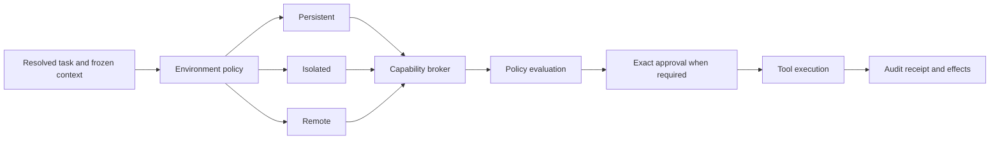

# Claude Code Harness Research for Omnia

- Status: Research complete; recommendations are informative, not shipped capabilities
- Research date: 2026-08-13
- Official repository: `anthropics/claude-code`
- Reviewed official repository commit: `be90077c6a353f292fa612d97173865a9ab21b83`
- Official repository commit timestamp: 2026-08-13T08:38:44Z
- Refresh verified at: 2026-08-13T12:25:00Z
- Refresh baseline: `9923819368179d7bb11b9d623fb480bf009b2e87`
- Refresh range: one official changelog/feed-only commit
- Official repository license notice: Anthropic PBC, all rights reserved; use is subject to Anthropic commercial terms
- Official documentation snapshot: fetched from `code.claude.com` on 2026-08-13
- Related Omnia research: [`OPENAI_CODEX_HARNESS_RESEARCH.md`](OPENAI_CODEX_HARNESS_RESEARCH.md)

## 1. Purpose

This document turns publicly documented Claude Code behavior, official plugin
examples, release history, and visual interaction evidence into independent
requirements for the Omnia harness. It is not a source-code port, a prompt
copy, an asset inventory, or a claim that Omnia already implements the
capabilities described here.

The useful comparison is architectural:

- how a long-lived agent session is persisted, resumed, branched, compacted,
  interrupted, and recovered;
- how tools, permissions, sandboxing, hooks, agents, skills, memory, plugins,
  worktrees, checkpoints, and telemetry fit together;
- how verbose activity is reduced to an understandable live interface;
- which production edge cases deserve deterministic tests before Omnia enables
  persistent machines, browser control, code execution, or remote clients.

Omnia should reproduce the valuable invariants through its own protocol, data
model, UI, tests, Windows security boundary, and icon language.

## 2. Provenance and clean-room boundary

### 2.1 The user-provided snapshot is excluded from implementation research

The user supplied this pinned repository snapshot:

```text
https://github.com/tanbiralam/claude-code/tree/6f6f12b37f529488b10e53928dd5508bb93535c7
```

The repository metadata says that the original source belongs to Anthropic,
the pinned tree contains no license file, and its README explicitly describes
the material as leaked source recovered from a source map. That is not a clean
or reusable provenance basis for a publishable Omnia repository.

Therefore:

- no source file, prompt, algorithm implementation, bundled dependency, icon,
  screenshot, animation, or other asset from that snapshot was copied into
  Omnia;
- no behavior in this document depends on inspecting its implementation;
- the snapshot is cited only to record why it was excluded;
- all detailed findings below come from Anthropic's official repository and
  official documentation, or from the separately documented Apache-2.0 Codex
  source review.

This boundary is stricter than merely avoiding a direct file copy. Omnia must
not reproduce distinctive non-public implementation structure learned only
from unlicensed material.

### 2.2 Official Claude Code sources are reference material, not an open-source base

The official `anthropics/claude-code` repository at the reviewed commit is
publicly accessible, but its license notice is not a permissive open-source
license. It exposes release notes, examples, plugins, commands, skills, agents,
hooks, configuration examples, and a demonstration animation. It does not
provide a clean license to transplant those files into Omnia.

Omnia may learn high-level product and architecture patterns, but should:

- implement its own contracts and wording;
- create its own vector icons and visual composition;
- avoid copying official plugin prompts or scripts verbatim;
- preserve source attribution in research notes when a pattern materially
  influenced an Omnia decision;
- run a dependency and license review before using any third-party code.

### 2.3 Source confidence levels

| Level | Evidence | How this document uses it |
|---|---|---|
| A | Official, pinned repository files | Stable evidence for repository contents, license, plugin structure, examples, and demo assets at one commit. |
| B | Official live documentation fetched on 2026-08-13 | Current product behavior and configuration contracts; not commit-pinned and therefore subject to later change. |
| C | Official changelog entries | Evidence that a class of edge case occurred; not a substitute for a stable public protocol. |
| D | Visual inspection of official demo media | Interaction and hierarchy observations only; no pixels, colors, fonts, mascots, or layouts are copied. |
| Excluded | The user-provided leaked snapshot | Provenance warning only. No implementation finding is derived from it. |

## 3. Executive findings

The strongest Claude Code patterns for Omnia are:

1. Persist the session continuously and model resume, branch, clear, compact,
   steer, and interrupt as different operations.
2. Restore state explicitly. High-risk permission modes and transient launch
   flags must not silently return after resume.
3. Treat context as a budgeted collection of typed layers with lazy loading,
   provenance, survival rules, and an inspectable occupancy view.
4. Use subagents to isolate noisy investigation rather than placing every file
   read, search result, and log in the main context.
5. Make compaction a first-class checkpoint with lifecycle hooks and explicit
   preservation rules, not an opaque summary string.
6. Keep policy enforcement outside the model. Deny rules, sandbox boundaries,
   workspace trust, and user-interaction requirements remain authoritative.
7. Separate permission policy from OS sandboxing. A permissive model mode does
   not widen filesystem or network containment.
8. Give every lifecycle boundary a typed event so plugins and policy code do
   not scrape terminal text or internal transcript files.
9. Represent specialized agents as durable, inspectable executions with their
   own context, permissions, model, tools, memory, budget, and transcript.
10. Package reusable workflows from skills, agents, hooks, MCP servers, LSP
    servers, monitors, and optional presentation assets, while keeping plugin
    trust and capability changes visible.
11. Preserve user control over automatic learning. Memory is inspectable,
    scoped, editable, and disableable.
12. Correlate prompts, model requests, tool calls, approvals, hooks, subagents,
    cache use, token use, cost, and errors in one redacted trace.
13. Separate prompt suggestions, side questions, action suggestions, and prompt
    workshops; each has a different history, tool, cost, and mutation contract.
14. Build autonomous quality loops from explicit completion gates, budgets,
    repeat detection, and independent reviewers instead of an unbounded
    “continue until perfect” prompt.

Claude Code and Codex emphasize complementary strengths. Claude Code's public
surface is especially useful for workflow packaging, hooks, role definitions,
session UX, worktree isolation, telemetry, and incremental customization.
Codex's open source is especially useful for protocol, replay, context-world
state, exact approvals, typed tool dispatch, and persisted agent topology.
Omnia should combine those strengths without inheriting either product's
historical constraints.

## 4. Comparative architecture map

| Concern | Claude Code public pattern | Codex public pattern | Omnia decision |
|---|---|---|---|
| User container | Saved session tied to a project, with resume and branch | Thread with start, resume, fork, archive and paginated history | Project -> task/thread -> run -> attempt -> iteration -> item/event |
| Mid-run input | Interrupt and steer; side questions are independent | Typed `turn/steer` with expected active turn ID | Typed steer with precondition, target item, author, timestamp and delivery receipt |
| Persistence | Local JSONL transcript plus separate task, team and memory files | Append-oriented rollout plus query/state projections | Append-only event journal plus transactional relational projections and encrypted content blobs |
| Context | Startup layers, lazy path rules, skills, memory, MCP metadata and compaction | Versioned context manager, world-state baseline and replacement-history checkpoints | Frozen context snapshot with selected and omitted items, reasons, hashes, authority and citations |
| Permissions | Deny/ask/allow precedence, permission modes, workspace trust and OS sandbox | Exact approval actions, permission profiles, guardian/user reviewer and sandbox policy | Capability broker plus exact operation receipt; environment selection and permission policy stay orthogonal |
| Extensibility | Skills, agents, hooks, MCP, LSP, monitors, themes and plugins | Skills, plugins, MCP, hooks, dynamic tools and generated protocol schemas | Signed/versioned Omnia extensions with declarative capability manifests and isolated runtimes |
| Parallelism | Subagents, forks, agent teams, task lists, mailboxes and worktrees | Child threads, agent registry, persisted edges, status subscriptions and resource limits | Durable agent DAG with typed inputs/outputs, ownership, leases, budgets, environments and merge gates |
| Memory | Plain Markdown auto-memory index plus topic files; scoped agent memory | Extraction/consolidation pipeline with citations in current source | Versioned memory records with proposals, evidence, contradictions, supersession and human-readable projections |
| Recovery | Resume, branch, checkpoint rewind and worktree retention | Rollout replay, interrupted boundaries, rollback and fork reconstruction | Crash-safe replay plus explicit recovery mode, unknown-attempt handling and reversible side-effect ledger |
| Observability | OTel metrics, events and traces with prompt/request/tool IDs | Request, stream, compaction, tool and timing telemetry | Provider-neutral trace graph with TTFT, TTFM, TPS, cost, cache, reasoning, policy, agent and outcome attribution |

## 5. Omnia's unified lifecycle model

### 5.1 Separate product state from execution state

Claude Code calls its durable user-visible unit a session. Codex calls the
equivalent protocol unit a thread. Omnia should avoid forcing every subsystem
into either word and use a graph with explicit layers:

```text
Project
  -> Task / Conversation Thread
       -> Branch
            -> Run
                 -> Provider Attempt
                      -> Agentic Iteration
                           -> Item / Event
```

- A **project** owns policy, workspace grants, knowledge, skills, provider
  defaults, environments, and durable overview artifacts.
- A **task/thread** owns the human conversation and goal.
- A **branch** is an immutable ancestry choice, not a mutable chat array.
- A **run** is one user-authorized execution of an intent.
- An **attempt** is one potentially billable provider interaction.
- An **iteration** is one model/tool cycle within a run.
- An **item/event** is the smallest durable streamed fact.

The desktop, web, CLI, IDE, and Android clients are projections over this graph.
They must not invent incompatible session formats.

### 5.2 Start, resume, branch, clear, compact, rewind, and retry differ

These operations must remain distinct:

| Operation | Semantics |
|---|---|
| Start | Create a new task/thread with a new policy and context baseline. |
| Resume | Rejoin the same durable identity and reconstruct its latest surviving state. |
| Branch | Create a new identity whose ancestry ends at an explicit event/turn boundary. |
| Clear | End the active conversational context and start a fresh branch while preserving the old branch for history. |
| Compact | Replace model-visible history with a checkpoint while retaining the original journal and provenance. |
| Rewind conversation | Move the active branch pointer without changing files. |
| Restore effects | Apply a separately verified inverse/snapshot operation to files or environment state. |
| Retry attempt | Repeat transport/provider work under explicit idempotency rules without creating a new user turn. |
| Regenerate | Create a sibling run from the same frozen user input and context. |

Treating these as aliases creates subtle corruption: duplicated provider
charges, background output landing on the wrong branch, stale permissions,
lost goals, or a replay that combines main-agent and subagent history.

### 5.3 Resume state must be explicit and risk-aware

Claude Code documents that some state returns on resume and some must be
provided again. Omnia should formalize that behavior in a typed
`ResumeManifest` rather than relying on scattered defaults.

The manifest should include:

```ts
interface ResumeManifest {
  threadId: string;
  branchId: string;
  journalCursor: string;
  contextCheckpointId?: string;
  activeGoalId?: string;
  environmentId?: string;
  environmentMode: "persistent" | "isolated" | "remote";
  permissionProfileId: string;
  providerProfileRevision: string;
  modelCatalogRevision: string;
  workspaceGrantRevision: string;
  extensionSetHash: string;
  pendingOperations: PendingOperationRef[];
  nonRestoredState: ResumeExclusion[];
}
```

Defaults:

- restore conversational and goal state only when its provenance is valid;
- restore a persistent environment by ID only when the user still owns it and
  the policy permits reconnection;
- never restore a bypass, admin, or temporary approval implicitly;
- re-evaluate current workspace grants, provider availability, extensions,
  network policy, and secrets by opaque handle;
- show a concise “restored / changed / unavailable” receipt before the next
  side effect;
- if an old provider attempt may have been accepted but completion is unknown,
  label it `unknown`, do not silently resend it.

### 5.4 Branching while work is active requires routing rules

Official Claude Code behavior shows why this is not merely a transcript copy:
background work can outlive the immediate foreground turn. Omnia should bind
every background producer to an output route:

```text
producer run/agent/task ID
  -> owning branch ID
  -> delivery policy: fixed | follow-active | inbox-only
  -> expected parent item ID
```

The default must be `fixed`: output returns to the branch that spawned the
work. `follow-active` is an explicit UI operation. This avoids surprising
behavior when the user branches while a tool, download, research job, or
subagent is still running.

## 6. Context, compaction, and “lost in the middle”

### 6.1 Context is a typed ledger, not a concatenated prompt

Claude Code's public context model includes startup instructions, auto memory,
skill descriptions, invoked skill bodies, MCP tool metadata, user messages,
assistant messages, file reads, path-scoped rules, nested instructions, hook
context, tool results, subagent summaries, and compaction summaries.

Omnia should record each candidate as a typed item:

```ts
interface ContextCandidate {
  id: string;
  sourceType:
    | "system_policy"
    | "user_instruction"
    | "project_instruction"
    | "conversation"
    | "memory"
    | "skill"
    | "file_chunk"
    | "retrieval_result"
    | "tool_result"
    | "agent_result"
    | "environment_state"
    | "artifact";
  authority: "system" | "user" | "project" | "retrieved";
  contentHash: string;
  versionId?: string;
  tokenEstimate: number;
  freshness: string;
  relevanceScore?: number;
  mustRetain: boolean;
  selected: boolean;
  selectionReason: string;
  omissionReason?: string;
  supersedes?: string[];
  conflictsWith?: string[];
}
```

The frozen snapshot sent to a provider must preserve both selected and omitted
items. Otherwise the system cannot explain why a source was absent, reproduce
an answer, or measure retrieval quality.

### 6.2 Use lazy, path-aware loading

Claude Code loads nested instructions and path-scoped rules when matching files
are accessed. Omnia should generalize this into conditional context rules:

- path and language patterns;
- project graph nodes;
- task intent and domain;
- active artifact type;
- environment and tool state;
- referenced source/citation;
- freshness or invalidation event.

Conditional material should not be dumped into every prompt. The project graph
and code index should emit a minimal relevant slice plus a stable reference to
the full source.

### 6.3 Compaction requires a survival contract

Claude Code publicly documents that different context mechanisms survive
compaction differently. Omnia should make survival a property of each item, not
an undocumented implementation detail:

```ts
type SurvivalPolicy =
  | "always_reinject"
  | "reinject_latest_revision"
  | "summarize_with_citations"
  | "reload_on_trigger"
  | "retain_exact"
  | "drop_after_checkpoint";
```

Mandatory exact survivors include:

- the current user request and later corrections;
- active goal and incomplete task graph;
- explicit scope, safety, output-format, and quality constraints;
- exact approvals still valid for pending operations;
- provider/tool calls without a terminal result;
- source/citation identities used by claims in progress;
- memory supersession records;
- branch ancestry and environment identity.

Summaries may compress narrative and completed tool details, but may not merge
two contradictory facts into one ambiguous statement.

### 6.4 Supersession fixes stale fact reuse

The user explicitly requires that when fact A is updated, Omnia use the new A
instead of continuing to use the old value or blending both. Implement this as
a graph, not prompt wording:

```text
Fact A revision 1 --superseded_by--> Fact A revision 2
                   \--contradicted_by--> Source/turn that caused the update
```

Context compilation rules:

1. select the newest active revision in the applicable scope;
2. retain older revisions only as historical evidence;
3. emit a contradiction item when authority or evidence is unresolved;
4. never include an active and superseded revision as co-equal instructions;
5. show the replacement in the memory/context inspector;
6. evaluate answer traces for stale-revision use.

### 6.5 Subagents protect the main context

Claude Code recommends delegating verbose exploration to a separate context so
only the findings return. Omnia should make this a routing decision with a
measured threshold:

- use the main run for information likely to be referenced repeatedly;
- use a fresh research agent for high-volume searches, logs, or file scans;
- use a fork when the agent needs the full conversation state;
- use a persistent specialist when accumulated domain memory is valuable;
- return a structured result with claims, evidence, unresolved questions,
  files/chunks inspected, and confidence—not only prose.

The parent decides which result fields enter its frozen context. Raw subagent
transcripts remain available in an inspector without occupying the main prompt.

### 6.6 Compaction quality telemetry

Each checkpoint should record:

- input tokens before and after;
- summary tokens and latency;
- cache read/write impact;
- exact items retained, summarized, reloaded, or omitted;
- constraint-recall score;
- citation-recall score;
- stale-fact and contradiction score;
- active goal/task retention;
- provider/model and summarizer version;
- user edits to the summary;
- downstream answer quality delta.

This lets Omnia improve its harness from evidence rather than subjective prompt
tweaks.

## 7. Environment selection, permissions, and sandboxing

### 7.1 “Auto environment” is not “automatic permission”

The user wants environment mode to default to `Auto`, selecting persistent or
isolated execution according to the current need. This decision must be
separate from whether a tool call is approved.



Suggested environment policy:

| Condition | Default environment |
|---|---|
| Trusted project, long-lived build state, local model, user-owned services | Persistent local machine |
| Untrusted archive, unknown repository, downloaded code, risky parser, destructive test | Isolated disposable machine |
| Cross-device execution or resources unavailable locally | Remote environment after destination/privacy policy |
| Ambiguous trust or required capability unavailable | Isolated, or stop for user choice |

`Auto` never means bypassing approval, CAPTCHA, access controls, administrator
consent, or network policy.

### 7.2 Policy precedence is monotonic

Claude Code documents a deny-before-ask-before-allow model. Omnia should use a
monotonic lattice:

```text
managed deny
  > user deny
  > project deny
  > mandatory user interaction
  > ask / approval required
  > temporary exact grant
  > scoped persistent allow
  > built-in safe default
```

A lower-authority source cannot turn a deny into an allow. A model, memory,
retrieved page, skill, subagent, plugin, hook, or teammate message can request a
capability but cannot grant it.

### 7.3 Approvals bind to the resolved operation

An Omnia approval receipt should bind at least:

```ts
interface ApprovalReceipt {
  approvalId: string;
  operationType: string;
  canonicalArgumentHash: string;
  environmentId: string;
  cwdOrTargetScopeHash: string;
  capabilitySetHash: string;
  toolImplementationVersion: string;
  workspaceGrantRevision: string;
  networkPolicyRevision?: string;
  secretHandleIds: string[];
  decision: "allow_once" | "allow_scope" | "deny" | "abort";
  decidedBy: "user" | "managed_policy" | "trusted_rule";
  issuedAt: string;
  expiresAt?: string;
  auditEventId: string;
}
```

Any material argument rewrite invalidates the old receipt and triggers a new
policy decision. Approving one command cannot approve a compound command,
different working directory, different environment, extra redirect, different
network destination, or extra capability.

### 7.4 Shell and PowerShell need semantic analysis

Claude Code's public permission documentation describes special handling for
compound commands, wrappers, aliases, redirects, working directories, globs,
UNC paths, and PowerShell ASTs. Omnia should not rely on prefix string matching.

Required approach:

- parse supported shells into an AST;
- canonicalize aliases and wrappers only with versioned, tested rules;
- evaluate every subcommand and redirect independently;
- fail closed when the parser cannot prove the requested boundary;
- make environment variables and command substitution explicit inputs;
- distinguish filesystem, process, network, registry, service, package-manager,
  device, and credential effects;
- execute the same canonical object that was reviewed;
- hash and persist that canonical object in the approval receipt.

On Windows, PowerShell, `cmd.exe`, WSL, MSYS/Git Bash, native executables, COM,
registry operations, scheduled tasks, services, and elevation have different
semantics. Each requires its own executor adapter and conformance suite.

### 7.5 Sandboxing is independent defense in depth

Permission rules influence which operation may be attempted. The environment
sandbox enforces what processes can actually reach. Omnia needs both:

- filesystem mounts with read/write/deny modes;
- network egress allowlists and local-network rules;
- process/job object limits;
- CPU, memory, disk, handle, output, and wall-clock budgets;
- secret injection by scoped handle, never raw vault export;
- device, clipboard, camera, microphone, display, registry, and IPC policies;
- environment snapshots and cleanup;
- audit of the effective policy after platform translation.

An extension or user-authored hook cannot weaken the sandbox. If the operating
system cannot enforce a requested profile, Omnia must fail closed or select a
stronger isolated environment.

### 7.6 Privileged Windows operations

Computer use should include typed system operations, but not silent privilege
escalation. Administrator, system-policy, service, driver, registry, Group
Policy, and protected-file actions should go through a privileged broker:

1. model proposes a typed operation;
2. broker resolves the exact target and impact;
3. UI shows current and proposed state plus rollback feasibility;
4. the user approves through Windows/UAC where applicable;
5. a narrow helper performs only the approved operation;
6. postcondition verification and an audit receipt are recorded.

Omnia must not silently obtain SYSTEM or TrustedInstaller authority. Those
identities are not ordinary “computer use” modes.

## 8. Hooks and lifecycle automation

### 8.1 Hooks should consume stable events

Claude Code exposes a broad lifecycle including session start, instruction
loading, prompt submission/expansion, message display, pre/post tool events,
permission requests and denials, subagent start/stop, task creation/completion,
worktree events, compaction, configuration changes, directory/file changes,
elicitation, stop, failure, and session end.

Omnia should offer a smaller stable kernel taxonomy with versioned extensions:

```text
session.*
run.*
attempt.*
iteration.*
context.*
tool.*
approval.*
agent.*
task.*
environment.*
artifact.*
memory.*
skill.*
provider.*
browser.*
capture.*
system.*
```

Each event carries IDs, sequence, timestamp, source, schema version, redaction
class, and a pointer to any large encrypted payload.

### 8.2 Event-specific hook contracts

Do not use one generic exit-code convention for every event. A hook definition
must declare:

```ts
interface HookContract {
  eventType: string;
  phase: "before" | "after" | "observe";
  handlerType: "process" | "http" | "wasm" | "model" | "agent";
  inputSchemaVersion: string;
  outputSchemaVersion: string;
  timeoutMs: number;
  failureMode: "deny" | "continue_with_warning" | "retry" | "disable_hook";
  mayBlock: boolean;
  mayRewriteInput: boolean;
  mayAddContext: boolean;
  capabilityManifest: string[];
  trustRevision: string;
}
```

Security hooks and policy gates fail closed. Cosmetic display hooks fail open.
Post-execution observers cannot retroactively make a failed action successful.
Input rewrites return a whole typed operation, which is revalidated and
re-approved if its canonical hash changes.

### 8.3 Hooks are not the policy engine

Official documentation warns that best-effort hook filters are not a complete
security boundary. Omnia should preserve this rule:

- core managed and user deny rules run even if a hook says allow;
- mandatory user interaction cannot be skipped by an untrusted hook;
- a hook cannot approve on behalf of another user or agent;
- hook output is untrusted data until schema validation and policy evaluation;
- hook-provided context is labeled with source and authority;
- timeouts and malformed responses are visible in the event journal;
- extension trust is invalidated when executable content or manifest hashes
  change.

### 8.4 Quality gates are first-class

Claude Code's public plugin examples use stop and task-completion hooks for
iterative development and test gates. Omnia should represent this directly:

```ts
interface CompletionGate {
  gateId: string;
  subjectId: string;
  evaluator: "deterministic" | "model" | "agent" | "human";
  requiredEvidence: EvidenceRequirement[];
  status: "pending" | "passed" | "failed" | "waived";
  attempts: number;
  maxAttempts: number;
  lastVerdict?: GateVerdict;
}
```

Examples include tests passing, typecheck clean, no critical security finding,
visual regression accepted, citation coverage threshold met, requested files
produced, and user approval obtained.

### 8.5 Autonomous loops must terminate safely

The official `ralph-wiggum` plugin demonstrates the value of repeated
implementation loops, but an Omnia loop cannot be an unbounded stop-hook trick.
Every loop needs:

- an explicit objective and measurable exit gates;
- wall-clock, token, cost, tool-call, subagent, and mutation budgets;
- no-progress and repeated-action detection;
- checkpoint before risky mutation;
- error-class-specific retry policy with jitter;
- independent verification, not self-declared completion;
- partial-result preservation;
- user-visible pause, steer, cancel, and inspect controls;
- a terminal reason: completed, budget exhausted, policy denied, blocked,
  cancelled, or failed.

## 9. Tools, MCP, and extension packaging

### 9.1 Typed tools with explicit effects

Tool metadata should include:

```ts
interface ToolDescriptor {
  canonicalName: string;
  version: string;
  inputSchema: object;
  outputSchema: object;
  effects: Array<
    | "read"
    | "write"
    | "execute"
    | "network"
    | "browser"
    | "computer"
    | "privileged"
    | "secret_use"
  >;
  capabilities: string[];
  environmentKinds: string[];
  concurrency: "serial" | "parallel_safe" | "keyed";
  idempotency: "none" | "caller_key" | "intrinsic";
  cancellation: "cooperative" | "killable" | "not_supported";
  outputRetention: "inline" | "blob" | "artifact" | "ephemeral";
  requiresUserInteraction: boolean;
}
```

The renderer receives a presentational projection, not an executable callback.

### 9.2 Tool discovery must be deferred

Large MCP catalogs consume context before any useful work begins. Claude Code's
public docs describe deferred tool search. Omnia should:

- always expose a tiny kernel tool set;
- index extension/tool metadata outside the prompt;
- retrieve tool descriptions by intent and capability;
- freeze the selected schema revisions into the run snapshot;
- show which tools were considered, loaded, or omitted;
- prevent a late tool-schema change from mutating an active run.

### 9.3 MCP is a transport, not a trust level

MCP tools may be local or remote, user or project scoped, authenticated or
anonymous, and interactive or autonomous. Every MCP server needs:

- origin and installation scope;
- transport and endpoint policy;
- authentication handle provenance;
- capability/effect manifest;
- tool schema hash and change history;
- connection health, latency, error and rate-limit metrics;
- output size and content-class policy;
- approval rules per tool;
- revocation and reconnect behavior;
- sandboxing for local server processes.

### 9.4 Plugin composition

The official Claude Code repository demonstrates plugins that bundle commands,
agents, skills, hooks, MCP integrations, learning styles, review workflows, and
security guidance. Current public docs additionally describe LSP servers,
monitors, themes, installation scopes, caching, persistent plugin data, and
path traversal limits.

An Omnia plugin manifest should support:

```text
manifest
skills/
agents/
workflows/
hooks/
tools/
mcp/
lsp/
monitors/
renderers/
themes/
icons/
assets/
migrations/
tests/
```

But installation must show a capability diff:

- processes it may launch;
- paths it may read or write;
- network destinations;
- secrets it may use by handle;
- UI surfaces it may contribute;
- hooks and lifecycle events it intercepts;
- models/providers it may call;
- persistent storage it owns;
- migrations and rollback support.

Updates that widen capability scope require renewed approval. Plugin code runs
outside the renderer and outside the trusted kernel, ideally in a constrained
process or WASM runtime.

### 9.5 Workflow templates from official plugin patterns

The official public plugin collection contains several useful high-level
patterns:

- **Feature development:** discovery, repository exploration, clarification,
  multiple architecture approaches, implementation, independent review, and
  summary.
- **PR review:** separate reviewers for comments, tests, silent failures, type
  design, general correctness, and simplification.
- **Hook authoring:** turn conversational intent into a reviewable deterministic
  rule rather than leaving the behavior as prompt text.
- **Security guidance:** inspect risky changes at tool boundaries.
- **Learning mode:** mix explanation with carefully chosen user exercises.
- **Iterative loop:** continue work until an explicit completion condition.

Omnia should implement these as data-driven workflow templates with typed
inputs, gates, budgets, roles, artifacts, and evaluation records. It should not
copy official prompt text.

## 10. Agents, teams, and orchestration

### 10.1 An agent is a durable run role

Claude Code's public subagent model exposes role description, tools, denied
tools, model, permission mode, maximum turns, preloaded skills, MCP servers,
hooks, memory scope, background preference, effort, worktree isolation, color,
and an initial prompt.

Omnia should model an agent template separately from an agent instance:

```ts
interface AgentTemplate {
  templateId: string;
  revision: string;
  name: string;
  purpose: string;
  iconId: string;
  modelPolicy: ModelRoutingPolicy;
  effortPolicy: EffortPolicy;
  capabilityCeiling: string[];
  toolSelectors: string[];
  skillRevisions: string[];
  memoryPolicy: AgentMemoryPolicy;
  environmentPolicy: AgentEnvironmentPolicy;
  budgets: AgentBudgetDefaults;
  completionGates: string[];
}

interface AgentInstance {
  agentId: string;
  templateRevision: string;
  parentAgentId?: string;
  owningRunId: string;
  environmentId: string;
  contextSnapshotId: string;
  status: AgentStatus;
  budgetLedgerId: string;
  transcriptStreamId: string;
}
```

### 10.2 Fresh subagent, fork, and teammate are different

| Mode | Initial context | Best use |
|---|---|---|
| Fresh specialist | Task packet plus selected project context | Noisy research, focused validation, cheap parallel work |
| Conversation fork | Parent context and branch ancestry | Side task that depends on nuanced discussion history |
| Persistent specialist | Fresh run plus scoped long-term memory | Repeated domain work across sessions |
| Team teammate | Independent context plus shared task graph/mailbox | Coordinated parallel work with dependencies and peer messaging |

The UI should ask for none of these terms during ordinary use. The orchestrator
chooses a safe default and exposes the choice in the run inspector.

### 10.3 Capability inheritance only narrows

A child agent's effective capabilities are:

```text
parent ceiling
INTERSECT template ceiling
INTERSECT environment policy
INTERSECT current workspace grants
INTERSECT user/managed policy
```

Messages from another agent are untrusted task direction. They do not count as
user consent, cannot approve a pending operation, and cannot change policy.

### 10.4 Agent identity must not rely on display names

Claude Code documents stale-name protection when resuming or messaging an
agent. Omnia should use immutable IDs and treat names as labels. A send request
may include an expected identity/version precondition so a recycled label
cannot receive the wrong message.

### 10.5 Separate task graph from process registry

The task checklist, background process list, agent list, goal, and plan are
related but distinct:

```text
Goal
  -> Plan nodes
       -> Tasks and dependencies
            -> Assigned agent/run
                 -> Processes/tools
                      -> Evidence and artifacts
```

This separation enables a task to survive agent failure, reassignment, model
switch, environment restart, or context compaction.

### 10.6 Agent team communication

Use a transactional mailbox or event stream rather than shared files as the
authoritative protocol. Every message records:

- sender and recipient IDs;
- owning goal/task/run;
- message type and schema;
- delivery sequence and acknowledgement;
- authority (`agent`, never `user`);
- content hash and redaction class;
- expiry and deduplication key.

Malformed messages are quarantined individually; one bad entry cannot block an
entire mailbox.

### 10.7 Parallel work needs conflict control

For code and document mutation:

- use isolated worktrees, branches, document revisions, or copy-on-write
  environments;
- assign explicit ownership for overlapping files/artifacts;
- detect collisions before merge;
- require a merge/review agent to reconcile results;
- retain unmerged work when cleanup runs;
- never delete a worktree with untracked changes or unpushed commits;
- lock active workspaces against concurrent cleanup.

For research, share immutable source IDs and deduplicate retrieved content
instead of copying large raw results between agents.

### 10.8 Resource controls

Agent orchestration needs independent ceilings for:

- active concurrency;
- nesting depth;
- total agents per run and per day;
- model/cost tier;
- tokens and context occupancy;
- wall time and idle time;
- tool calls and retries;
- filesystem/network effects;
- output size;
- persistent environment count.

Limit failures are terminal typed outcomes, not invitations for the model to
retry immediately.

## 11. Skills, instructions, and memory

### 11.1 Match the mechanism to the scope

Claude Code distinguishes always-loaded project instructions, conditional
rules, reusable skills, agent definitions, hooks, and auto memory. Omnia should
offer a unified editor while preserving the semantics:

| Need | Omnia mechanism |
|---|---|
| Durable rule for everyone in a project | Project instruction revision |
| Personal default across projects | User instruction revision |
| Path/domain conditional guidance | Conditional context rule |
| Reusable workflow or knowledge package | Skill |
| Deterministic enforcement | Policy or hook |
| Specialized execution role | Agent template |
| Learned fact/pattern | Memory proposal and revision |
| External action/data source | Tool/MCP/connector |

### 11.2 Progressive disclosure for skills

Adopt the useful skill-loading pattern:

1. keep a compact catalog entry in discovery context;
2. load the full workflow only when selected;
3. keep large references and examples in separate files;
4. load only the resource required for the current step;
5. pin the exact skill revision in the run snapshot;
6. show invocation source: user, orchestrator, workflow, or nested skill;
7. evaluate whether the skill improved the result.

An Omnia skill manifest may include:

```ts
interface SkillManifest {
  skillId: string;
  revision: string;
  name: string;
  description: string;
  triggers: SkillTrigger[];
  invocation: "user_only" | "agent_allowed" | "automatic";
  execution: "inline" | "fresh_agent" | "forked_agent";
  defaultModelPolicy?: ModelRoutingPolicy;
  defaultEffort?: string;
  requestedCapabilities: string[];
  deniedCapabilities: string[];
  conditionalPaths?: string[];
  hooks?: HookRef[];
  references: SkillResourceRef[];
  license?: string;
  provenance: Provenance;
}
```

Unlike Claude Code's documented one-turn `allowed-tools` convenience, an Omnia
skill never grants itself a capability. It declares requested capabilities;
the broker resolves them through existing policy and exact approval.

### 11.3 Memory should not be transcript dumping

Claude Code's auto memory uses a concise `MEMORY.md` index and optional topic
files, scoped per repository. Omnia should keep the human-readable advantage
but make structured records authoritative:

```ts
interface MemoryRevision {
  memoryId: string;
  revisionId: string;
  scope: "global" | "project" | "workspace" | "assistant" | "agent" | "task";
  kind: "preference" | "fact" | "procedure" | "decision" | "lesson";
  statement: string;
  status: "proposed" | "active" | "superseded" | "rejected" | "expired";
  evidence: EvidenceRef[];
  confidence: number;
  sensitivity: string;
  createdBy: "user" | "agent" | "import";
  supersedesRevisionId?: string;
  expiresAt?: string;
}
```

The Markdown view is generated from these records and can be edited through a
validated round trip.

### 11.4 Automatic memory lifecycle

1. detect a candidate from user correction, repeated preference, successful
   workflow, or stable project fact;
2. classify sensitivity and scope;
3. attach evidence and proposed supersession links;
4. reject secrets, credentials, access tokens, or highly sensitive inference
   unless the user explicitly requests storage in an appropriate vault;
5. automatically activate only low-risk, high-confidence configured classes;
6. keep other candidates pending for review;
7. retrieve by hybrid search plus scope/freshness/authority filters;
8. show every injected revision in the run inspector;
9. evaluate utility and stale-use rate;
10. consolidate, expire, or supersede without deleting historical evidence.

Temporary/private tasks default to no memory reads and no memory writes.

### 11.5 Agent memory is separate from user truth

Specialists may keep working notes, but agent memory has lower authority than
user/project memory. It should store locations, debugging patterns, repeated
tool usage, and domain summaries—not silently redefine user preferences or
security policy.

## 12. Checkpoints, effects, and recovery

### 12.1 Conversation rewind and effect rollback differ

Claude Code's checkpoint documentation explicitly notes that some Bash,
subagent, external, symlink, and hard-link changes are not restored. Omnia must
not present a universal undo button unless it can prove coverage.

For every side-effecting operation, record:

- precondition and prior state hash;
- executor/environment identity;
- exact approved operation;
- observed changed resources;
- postcondition and new state hash;
- rollback method: inverse operation, snapshot restore, version-control
  revert, compensating action, or unavailable;
- rollback risk and approval requirement.

The UI labels checkpoints as:

- `conversation only`;
- `files covered`;
- `environment snapshot`;
- `partial effects`;
- `not reversible`.

### 12.2 Capture changes from every executor

Direct editor writes, shell processes, language servers, formatters, package
managers, subagents, browser downloads, computer use, privileged helpers, and
remote environments must report effects through the same ledger. Where exact
interception is impossible, use environment snapshots or state clearly that
rollback is partial.

### 12.3 Crash recovery

Recovery proceeds from durable facts:

1. replay the append-only journal to the last committed cursor;
2. rebuild projections;
3. identify runs without terminal events;
4. query resumable providers/tools/environments by remote ID where supported;
5. classify each as resumable, completed remotely, cancelled, failed, or
   unknown;
6. never repeat an unknown billable or destructive operation automatically;
7. surface a recovery inbox with safe actions;
8. preserve partial assistant output, tool output, files, and artifacts.

## 13. Telemetry and adaptive orchestration

### 13.1 One trace from intent to outcome

Claude Code's documented OTel hierarchy links an interaction to model requests,
tools, permission wait, execution, hooks, and subagents. Omnia should extend it:

```text
omnia.intent
  -> omnia.context.compile
  -> omnia.route.select
  -> omnia.environment.prepare
  -> omnia.provider.request
       -> retry attempts / stream
  -> omnia.tool.call
       -> policy
       -> approval wait
       -> execution
       -> verification
  -> omnia.agent.run
  -> omnia.artifact.commit
  -> omnia.evaluation
  -> omnia.memory.proposal
```

W3C trace context should flow through trusted child processes and compatible
remote services. It must not be sent to arbitrary providers or sites without a
declared privacy policy.

### 13.2 Required measurements

Per provider request:

- provider profile and model revision;
- selected endpoint/region and route reason;
- start, connect, first byte, TTFT, first message, end;
- input, cached input, cache write, reasoning, visible output, audio/image and
  other modality tokens or equivalent units;
- output tokens per second;
- retry attempts, fallback hops, status, provider request ID;
- estimated and reconciled cost;
- context snapshot ID and occupancy;
- stop reason and structured error.

Per prompt/run:

- prompt ID, user message ID, run/attempt/branch IDs;
- time in context compile, routing, queue, sampling, compaction, approval,
  tools, verification, and idle wait;
- agent/skill/plugin/MCP/tool attribution;
- citations and source coverage;
- tasks/gates completed;
- artifacts produced;
- user edits, reruns, accepts, rejects, and final outcome rating;
- memory candidates and later utility;
- chosen suggestion and whether it helped.

Per provider/model health:

- RPM/TPM headroom and throttle events;
- success rate by capability;
- latency percentiles and TTFT;
- stream interruption and malformed-output rate;
- tool-call/schema adherence;
- context/caching behavior;
- cost accuracy;
- last successful conformance probe;
- availability state: healthy, degraded, rate-limited, auth-failed,
  incompatible, or unknown.

### 13.3 Default privacy

Telemetry is local-first and content-redacted by default. Raw prompts, model
payloads, files, tool input/output, screenshots, cookies, signed URLs, secrets,
and memory text require separate explicit controls and retention. High-cardinality
names can be locally hashed or grouped while retaining a private local drilldown.

### 13.4 Learning router, not uncontrolled reinforcement learning

The user wants reinforcement learning to improve routing and orchestration.
Start with an auditable contextual-bandit/offline-evaluation loop:

1. log candidate routes and the selected route;
2. calculate reward from quality gates, user correction, latency, cost,
   reliability, citation coverage, and task success;
3. train or tune only on redacted, consented features;
4. validate offline against fixed evaluation suites;
5. canary the new policy with a reversible version;
6. keep hard policy, permissions, safety, and provider constraints outside the
   learned component;
7. retain an explanation and fallback for every routing decision.

A learned policy may rank safe options. It may not create new capabilities,
hide costs, or bypass approval.

## 14. Prompt workshop, side questions, and suggestions

### 14.1 Separate four concepts

| Surface | Purpose | History | Tools | Mutation |
|---|---|---|---|---|
| Prompt suggestion | Predict a likely next prompt | Not sent until accepted | None | None |
| Action suggestion | Offer a concrete product action such as add tests or research deeper | Recorded only if invoked | Depends on action | Explicit |
| Side question (`btw`) | Ask about what the current context already knows | Separate ephemeral side thread | None by default | None |
| Prompt workshop | Discuss, rewrite, compare, and finalize a future prompt | Separate durable/ephemeral workshop | Optional controlled research | Inserts only after user finalizes |

Mixing these in one autocomplete row makes cost, context, and agency unclear.

### 14.2 Omnia side question contract

Inspired by the public `/btw` interaction, Omnia's side question should:

- run without interrupting the active main run;
- read a frozen view of context available when submitted;
- exclude incomplete streaming text unless explicitly refreshed;
- have no tools, writes, memory writes, or approvals by default;
- never enter the main thread automatically;
- support a small side-thread history with configurable retention;
- show cost and model;
- promote the question/answer into a new branch or the main composer only when
  the user chooses;
- preserve citations to items in the frozen context.

### 14.3 Prompt workshop

The requested “enhance prompt, discuss, then finalize into the input box” flow
should be a first-class workspace:

1. capture the draft, target task, constraints, attachments, and desired output;
2. identify ambiguity and missing success criteria;
3. offer a one-click optimized draft or open a workshop;
4. let the user discuss with one or multiple models;
5. show changes as a semantic diff: intent, scope, constraints, context,
   deliverables, verification, and stop conditions;
6. allow reusable prompt-template extraction as a skill;
7. on “Finalize,” place the chosen prompt in the original composer without
   auto-sending;
8. preserve the workshop as linked provenance but keep it out of the target
   task context unless selected.

### 14.4 Suggestion engine

Generate separate ranked groups:

- continue/refine the answer;
- research deeper or broaden sources;
- verify, test, benchmark, or audit;
- create or update an artifact;
- add test coverage or simplify code;
- compare models/providers;
- extract memory or save a skill;
- branch, delegate, or create a checkpoint;
- adjust parameters for cost, speed, or depth.

Suggestion generation should reuse a warm cache when possible, skip or delay
when the expected value is below cost, and expose the reason it was suggested.
No suggestion is automatically executed.

## 15. Visual and interaction findings

### 15.1 Evidence reviewed

The official repository's `demo.gif` was inspected at five frames across its
42.4-second, 1552-by-992 animation. The official Codex repository splash image
was inspected separately for comparison. These assets were used only to study
information hierarchy. They are not copied into Omnia.

### 15.2 Useful interaction patterns

The Claude Code demo communicates a long-running task with a small set of
stable visual primitives:

- model, account/context, and working directory are visible near session
  identity;
- the submitted prompt remains visually distinct from activity;
- tool rows use a verb plus target and a nested one-line result;
- completed, active, muted, and error states are recognizable at a glance;
- the current activity includes an interrupt hint;
- a “next” line explains the near-term plan;
- thinking and tool detail can be expanded instead of occupying the whole
  screen;
- the input remains available while work is running;
- the task list and background process/agent list are separate concepts.

The Codex terminal splash similarly demonstrates a compact plan with one active
step, muted pending steps, concise commentary, and an event-like activity
timeline.

### 15.3 What Omnia should not copy

- vendor wordmarks or mascots;
- Claude's pixel-art robot icon;
- exact color palette, typography, terminal framing, spacing, or animation;
- a monospaced terminal aesthetic for the main desktop shell;
- color as the only status signal;
- generic sparkle, robot-head, magic-wand, or multicolor-gradient iconography;
- a flat list that gives every low-level tool event equal visual weight.

### 15.4 Omnia desktop translation

Use a refined Windows 11 workbench with independent visual language:

- a calm application frame and high-information project/task header;
- a readable conversation/artifact canvas;
- a collapsible run inspector for plan, agents, tools, context, citations,
  approvals, environment, telemetry, and effects;
- event groups summarized by outcome, with exact details one expansion away;
- an always-available composer that can steer, queue, or create a side question;
- status expressed by icon, shape, text, and color;
- role-specific vector icons: compass for exploration, blueprint for
  architecture, beaker for tests, shield for security, lens for research,
  brackets for code, terminal prompt for execution, graph nodes for
  orchestration, archive for artifacts, and bookmark layers for memory;
- one coherent 16/20/24-pixel SVG grid with consistent stroke, optical weight,
  corner radius, filled/outline states, and high-contrast variants;
- motion used to explain state transitions, not decorate static surfaces.

The project overview should update from meaningful milestones—index revision,
architecture decision, artifact publication, dependency change, or completed
goal—not on every chat message.

## 16. Important edge cases exposed by public release history

The official changelog documents repeated fixes in several classes. Omnia
should treat the classes as design input, without copying implementation:

- resume from long or branched sessions losing context or choosing a dead-end
  chain;
- compaction losing instructions, skills, model state, cache behavior, or task
  state;
- partial assistant output disappearing after interruption;
- subagent completion failing to report partial progress;
- subagent worktree/cwd state leaking into the parent;
- permission parsing bypasses in compound Bash and PowerShell commands;
- deny rules being weakened by hooks or configuration precedence mistakes;
- settings changes not revoking directory access during a running session;
- stale names or paths delivering messages to the wrong agent/session;
- malformed MCP output hanging a run;
- MCP tools missing during asynchronous connection startup;
- large outputs and transcripts causing memory growth or quadratic writes;
- telemetry losing attribution or exposing content without opt-in;
- cleanup deleting worktrees with untracked work;
- checkpoint UI implying restoration for edits it does not cover.

These are evidence that lifecycle state, policy state, context state, and UI
state need separate authoritative models.

The August 13 refresh adds one new release-history edge case: MCP OAuth can fail
when a pre-registered client expects an exact redirect URI. No harness or plugin
implementation files changed between the previous pin and the refreshed pin;
the change was limited to `CHANGELOG.md` and `feed.xml`. Omnia should therefore
treat this as C-level operational evidence, not as a newly inspected protocol.

Omnia implication:

- Persist the exact redirect URI and OAuth client registration mode in the
  connection attempt receipt.
- Compare the callback origin, host, port and path byte-for-byte against the
  registration contract before opening the browser or exchanging a code.
- Do not silently rewrite `localhost`, `127.0.0.1`, scheme, port or path.
- Surface a redacted `oauth_redirect_uri_mismatch` diagnostic that identifies
  which component differs without exposing authorization codes or client
  secrets.

## 17. Deterministic Omnia test catalog

### 17.1 Session, branch, and recovery

- `resume_reconstructs_same_branch_and_cursor`
- `resume_does_not_restore_temporary_or_bypass_approval`
- `resume_reports_provider_model_or_extension_drift`
- `resume_unknown_billable_attempt_never_auto_retries`
- `branch_at_completed_turn_excludes_later_items`
- `branch_mid_turn_persists_interruption_boundary`
- `background_output_routes_to_spawn_branch_by_default`
- `duplicate_session_label_never_changes_identity_resolution`
- `clear_preserves_old_branch_and_starts_fresh_context`
- `crash_replay_preserves_partial_assistant_and_tool_output`
- `active_goal_survives_resume_without_reusing_old_budget_baseline`
- `projection_rebuild_matches_journal_hash`

### 17.2 Context and compaction

- `context_snapshot_records_selected_and_omitted_candidates`
- `current_user_correction_beats_every_memory_revision`
- `superseded_fact_is_not_selected_as_active`
- `conflicting_facts_emit_explicit_contradiction_item`
- `compaction_preserves_active_goal_tasks_and_approvals`
- `compaction_preserves_citation_source_ids`
- `compaction_reinjects_latest_project_instruction_revision`
- `conditional_rule_reloads_only_after_matching_trigger`
- `agent_summary_does_not_import_raw_noisy_transcript`
- `skill_revision_is_frozen_before_dispatch`
- `lost_in_middle_probe_recalls_pinned_constraints_at_multiple_positions`
- `compaction_quality_regression_blocks_policy_promotion`

### 17.3 Permissions and sandbox

- `deny_wins_over_hook_user_project_and_skill_allow`
- `agent_message_never_satisfies_user_approval`
- `changed_arguments_invalidate_approval_receipt`
- `changed_cwd_environment_or_redirect_invalidates_approval`
- `compound_shell_command_evaluates_every_subcommand`
- `powershell_aliases_and_ast_resolve_to_canonical_operations`
- `unparseable_shell_input_fails_closed`
- `unc_path_requires_network_filesystem_capability`
- `skill_declared_capability_does_not_self_grant`
- `revoked_workspace_grant_stops_active_and_future_access`
- `persistent_environment_does_not_imply_persistent_privilege`
- `sandbox_translation_failure_prevents_execution`
- `privileged_operation_requires_exact_uac_backed_receipt`

### 17.4 Hooks and plugins

- `hook_schema_mismatch_uses_event_specific_failure_mode`
- `security_hook_timeout_denies_operation`
- `display_hook_timeout_does_not_block_run`
- `hook_input_rewrite_is_revalidated_and_reapproved`
- `post_hook_cannot_change_persisted_tool_result`
- `extension_hash_change_invalidates_trust`
- `plugin_update_capability_diff_requires_new_approval`
- `malformed_plugin_event_is_quarantined_not_replayed_forever`
- `managed_hook_and_policy_cannot_be_disabled_by_project`
- `loop_stops_at_budget_or_no_progress_limit`
- `pre_registered_mcp_oauth_client_uses_exact_redirect_uri`
- `oauth_redirect_uri_mismatch_is_redacted_and_non_retrying`

### 17.5 Agents and tasks

- `fresh_agent_receives_task_packet_not_parent_transcript`
- `forked_agent_receives_exact_parent_checkpoint`
- `child_effective_capabilities_are_intersection_only`
- `agent_display_name_reuse_cannot_retarget_message`
- `agent_completion_preserves_partial_progress_on_failure`
- `agent_transcript_survives_parent_compaction`
- `agent_depth_and_concurrency_limits_are_shared_and_atomic`
- `failed_spawn_releases_resource_reservation`
- `task_dependency_unblocks_only_after_gate_passes`
- `worktree_cleanup_skips_changed_untracked_or_unpushed_work`
- `worktree_executor_cannot_escape_to_main_checkout`
- `merge_gate_detects_overlapping_agent_edits`

### 17.6 Checkpoints and effects

- `checkpoint_labels_coverage_before_user_can_restore`
- `shell_file_changes_enter_effect_ledger`
- `formatter_and_lsp_changes_enter_effect_ledger`
- `subagent_changes_enter_effect_ledger`
- `nonreversible_effect_never_claims_undo_support`
- `snapshot_restore_verifies_postcondition`
- `rollback_requires_new_approval_when_it_has_side_effects`

### 17.7 Telemetry and routing

- `prompt_request_tool_approval_agent_ids_form_one_trace`
- `ttft_ttfm_sampling_compaction_and_tool_wait_are_separate`
- `visible_output_tokens_exclude_reasoning_when_provider_reports_both`
- `cache_read_and_cache_write_are_attributed_per_attempt`
- `provider_health_distinguishes_auth_rate_limit_schema_and_transport`
- `raw_content_is_redacted_without_explicit_opt_in`
- `third_party_plugin_and_server_names_follow_privacy_policy`
- `router_decision_is_reproducible_from_logged_features`
- `learned_router_cannot_select_forbidden_provider_or_capability`
- `cost_reconciliation_preserves_estimate_and_final_invoice_values`

### 17.8 Prompt workshop and suggestions

- `side_question_never_mutates_main_history_by_default`
- `side_question_has_no_tools_or_memory_writes_by_default`
- `side_question_promotion_creates_explicit_branch_items`
- `prompt_workshop_finalize_inserts_but_does_not_auto_send`
- `suggestion_generation_skips_when_cache_cold_and_value_low`
- `action_and_prompt_suggestions_have_distinct_execution_contracts`
- `suggestion_cost_and_reason_are_visible`

## 18. Candidate ADRs

The research should feed independent decisions rather than one giant harness
document:

1. **Unified run graph and lifecycle operations** — identities, branches,
   attempts, iterations, background output routing, resume manifest, and
   unknown-operation recovery.
2. **Context ledger and compaction checkpoints** — candidate schema,
   authority, survival policy, supersession, frozen snapshots, retrieval and
   lost-in-the-middle evaluation.
3. **Capability broker and exact approval receipts** — precedence, canonical
   operations, environment binding, hooks, user interaction and privileged
   broker.
4. **Execution environments** — Auto selection, persistent/isolated/remote
   lifecycles, mounts, network, secrets, snapshots and cleanup.
5. **Agent DAG and task graph** — templates, instances, fresh/fork/team modes,
   mailboxes, budgets, worktrees and merge gates.
6. **Extension runtime** — skills, plugins, hooks, MCP, LSP, monitors, themes,
   trust, signing, isolation, update capability diffs and migrations.
7. **Memory lifecycle** — proposals, evidence, sensitivity, scopes,
   supersession, Markdown projection and evaluation.
8. **Effect ledger and checkpoints** — side-effect capture, rollback coverage,
   snapshots and recovery UX.
9. **Observability and adaptive routing** — trace schema, privacy, provider
   health, cost, quality signals and learned-policy boundaries.
10. **Prompt workshop and auxiliary conversations** — side questions,
    suggestions, multi-model discussion, promotion and history semantics.

## 19. Recommended implementation slices

### Slice A — lifecycle and journal

- finalize project/task/branch/run/attempt/iteration/item/event identities;
- implement append-only journal and rebuildable projections;
- start, steer, interrupt, resume, branch, clear and regeneration commands;
- preserve partial streaming output;
- add recovery inbox and unknown-attempt classification.

Exit gate: deterministic crash/replay tests produce byte-equivalent frozen run
inputs and no operation is automatically duplicated.

### Slice B — context and compaction

- implement typed context candidates and frozen snapshots;
- add authority, selection/omission reasons and content hashes;
- implement conditional context rules and hybrid retrieval;
- implement checkpoint compaction with survival policies;
- add supersession/contradiction graph and lost-in-the-middle evaluation.

Exit gate: active user constraints, source identities, goals and pending tool
state survive adversarial long-context tests.

### Slice C — environment and capability kernel

- define persistent, isolated and remote environment contracts;
- implement Auto environment policy with explanation;
- implement capability broker, exact receipts and policy precedence;
- add Windows-native shell/PowerShell canonicalization;
- add OS sandbox adapters and privileged-operation broker skeleton.

Exit gate: no model, skill, agent, hook, plugin, retrieved content, or stale
receipt can widen effective capability.

### Slice D — agents, tasks and checkpoints

- implement agent templates and durable instances;
- implement fresh/fork/persistent/team context modes;
- implement task DAG, mailbox, budgets and completion gates;
- add worktree/copy-on-write isolation and merge ownership;
- implement effect ledger and honest checkpoint coverage.

Exit gate: parallel agents can crash, resume, conflict, and merge without losing
work, confusing identity, or contaminating parent policy/context.

### Slice E — skills, plugins and memory

- implement progressive skill discovery and revision pinning;
- add extension manifests, capability diffs, trust and isolated runtime;
- implement versioned memory proposal/review/retrieval/supersession;
- generate human-readable memory and skill inspectors;
- add importers for common agent instruction formats without making them the
  internal source of truth.

Exit gate: every loaded instruction, skill, extension and memory revision is
inspectable, removable, attributable, evaluated and unable to self-grant power.

### Slice F — telemetry and interaction surfaces

- implement redacted event/metric/trace schema;
- add provider/model health and cost dashboards;
- add agent/task/run inspector and event grouping;
- implement side questions, prompt workshop and ranked suggestions;
- add offline routing evaluation and policy versioning;
- design and test Omnia's independent icon system.

Exit gate: a user can explain exactly why a route, context item, tool,
permission, agent, memory, citation, cost, or suggestion was used.

## 20. Public source map

### 20.1 Official repository, pinned at reviewed commit

- Repository root: <https://github.com/anthropics/claude-code/tree/be90077c6a353f292fa612d97173865a9ab21b83>
- License notice: <https://github.com/anthropics/claude-code/blob/be90077c6a353f292fa612d97173865a9ab21b83/LICENSE.md>
- Official plugin marketplace catalog: <https://github.com/anthropics/claude-code/blob/be90077c6a353f292fa612d97173865a9ab21b83/.claude-plugin/marketplace.json>
- Plugin overview: <https://github.com/anthropics/claude-code/blob/be90077c6a353f292fa612d97173865a9ab21b83/plugins/README.md>
- Feature-development workflow: <https://github.com/anthropics/claude-code/tree/be90077c6a353f292fa612d97173865a9ab21b83/plugins/feature-dev>
- PR review toolkit: <https://github.com/anthropics/claude-code/tree/be90077c6a353f292fa612d97173865a9ab21b83/plugins/pr-review-toolkit>
- Hook authoring example: <https://github.com/anthropics/claude-code/tree/be90077c6a353f292fa612d97173865a9ab21b83/plugins/hookify>
- Iterative-loop example: <https://github.com/anthropics/claude-code/tree/be90077c6a353f292fa612d97173865a9ab21b83/plugins/ralph-wiggum>
- Security-guidance example: <https://github.com/anthropics/claude-code/tree/be90077c6a353f292fa612d97173865a9ab21b83/plugins/security-guidance>
- Official demo animation: <https://github.com/anthropics/claude-code/blob/be90077c6a353f292fa612d97173865a9ab21b83/demo.gif>
- Changelog: <https://github.com/anthropics/claude-code/blob/be90077c6a353f292fa612d97173865a9ab21b83/CHANGELOG.md>
- Refresh comparison: <https://github.com/anthropics/claude-code/compare/9923819368179d7bb11b9d623fb480bf009b2e87...be90077c6a353f292fa612d97173865a9ab21b83>

### 20.2 Official documentation fetched on 2026-08-13

- Overview: <https://code.claude.com/docs/en/overview>
- How Claude Code works: <https://code.claude.com/docs/en/how-claude-code-works>
- Sessions: <https://code.claude.com/docs/en/sessions>
- Context window: <https://code.claude.com/docs/en/context-window>
- Permissions: <https://code.claude.com/docs/en/permissions>
- Permission modes: <https://code.claude.com/docs/en/permission-modes>
- Sandboxing: <https://code.claude.com/docs/en/sandboxing>
- Hooks: <https://code.claude.com/docs/en/hooks>
- Subagents: <https://code.claude.com/docs/en/sub-agents>
- Agent teams: <https://code.claude.com/docs/en/agent-teams>
- Agent view/background sessions: <https://code.claude.com/docs/en/agent-view>
- Cross-session messaging: <https://code.claude.com/docs/en/cross-session-messaging>
- Worktrees: <https://code.claude.com/docs/en/worktrees>
- Skills: <https://code.claude.com/docs/en/skills>
- Memory: <https://code.claude.com/docs/en/memory>
- Checkpointing: <https://code.claude.com/docs/en/checkpointing>
- MCP: <https://code.claude.com/docs/en/mcp>
- Plugins: <https://code.claude.com/docs/en/plugins>
- Plugin reference: <https://code.claude.com/docs/en/plugins-reference>
- Monitoring and OpenTelemetry: <https://code.claude.com/docs/en/monitoring-usage>
- Interactive mode, suggestions and side questions: <https://code.claude.com/docs/en/interactive-mode>
- Best practices: <https://code.claude.com/docs/en/best-practices>
- Feature comparison: <https://code.claude.com/docs/en/features-overview>

### 20.3 Excluded snapshot record

- User-provided snapshot, excluded for provenance: <https://github.com/tanbiralam/claude-code/tree/6f6f12b37f529488b10e53928dd5508bb93535c7>

## 21. Conclusion

Claude Code's public surface reinforces that a strong harness is not one clever
system prompt. It is a set of durable contracts around session identity,
context, policy, environments, tools, extensions, agents, recovery, telemetry,
and user control.

The most important Omnia upgrade is to make all of those mechanisms projections
of one kernel. Chat, IDE, browser, capture, computer use, persistent machines,
remote clients, documents, research, and coding agents should share the same
run graph, capability broker, context ledger, effect journal, agent DAG,
telemetry, and extension trust model.

That foundation lets Omnia add breadth without becoming an unsafe collection of
special-case integrations. It also makes quality measurable: every answer and
action can be traced back to the exact model, provider, context, memory, skill,
agent, source, permission, environment, tool, cost, and verification evidence
that produced it.
